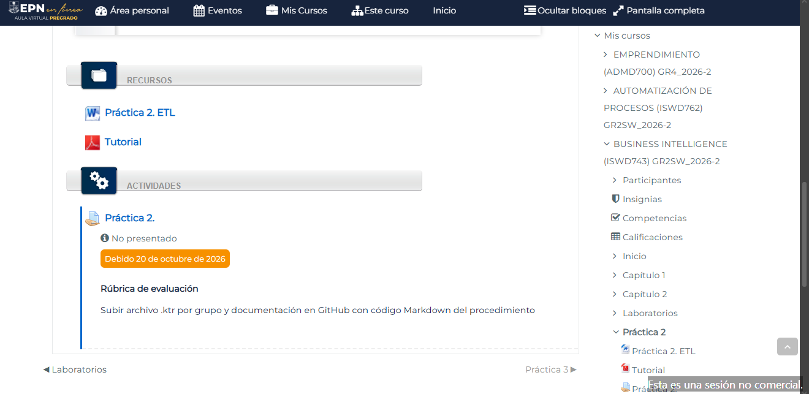
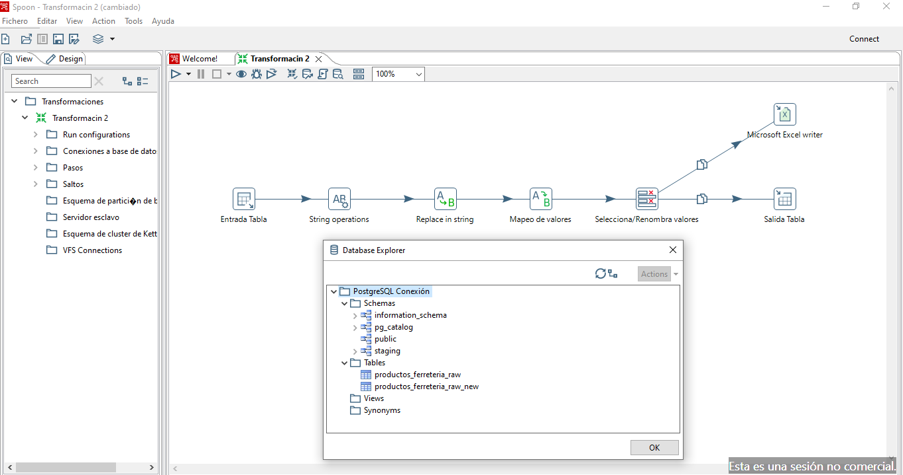
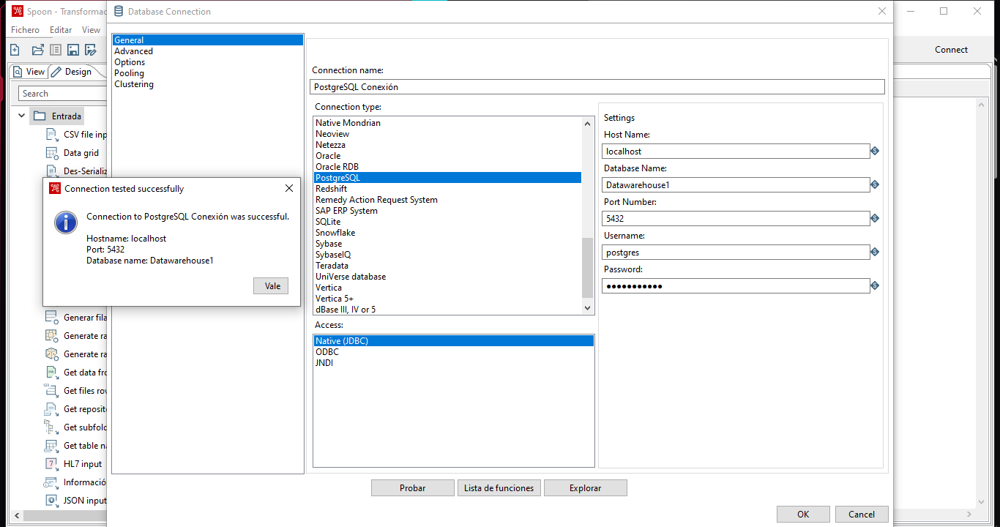
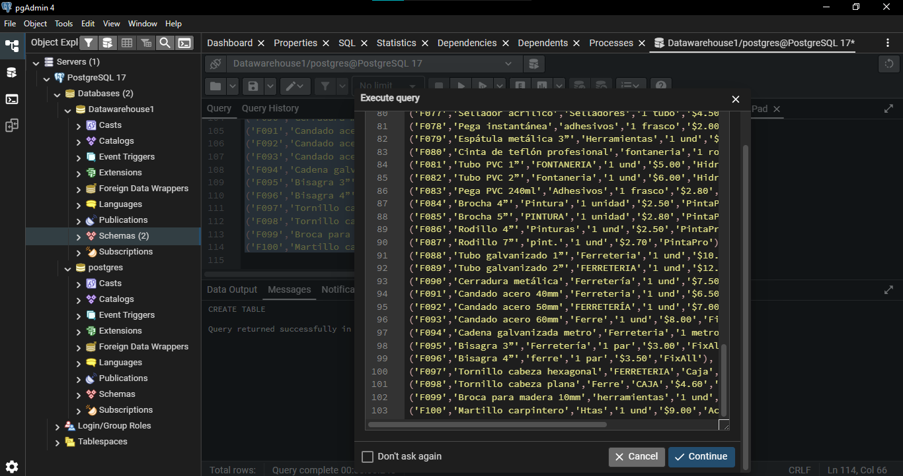
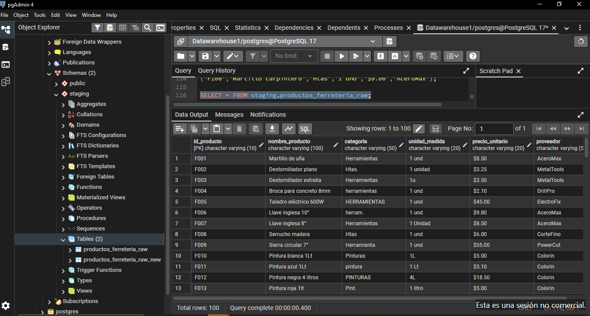
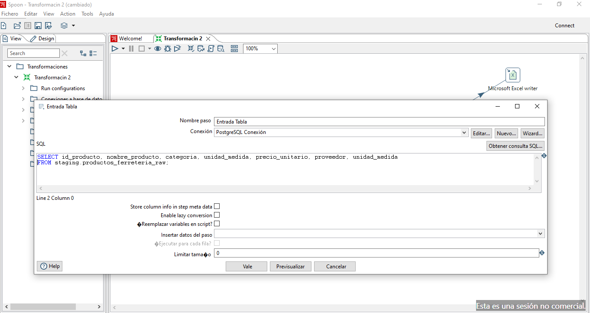
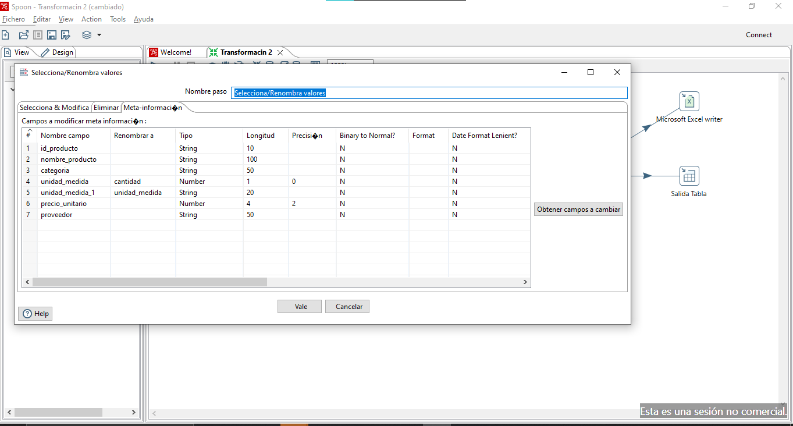
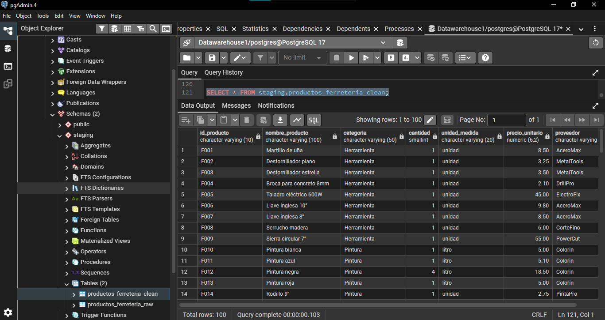
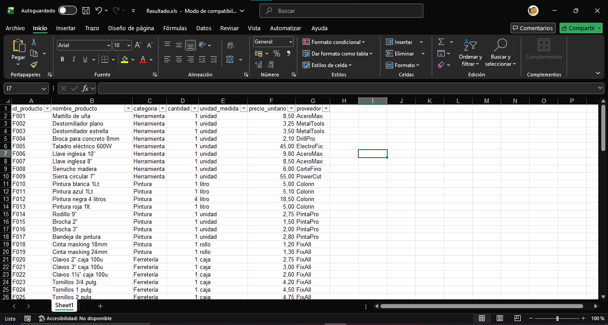

<div align="center" style="font-family: Arial, Helvetica, sans-serif; color: #0C233F; max-width: 900px; margin: 0 auto;">

  <!-- Encabezado institucional -->
  <div style="background-color: #0C233F; padding: 32px 20px; border-radius: 8px 8px 0 0;">
  
<h1 style="color: #FFFFFF; font-size: 25px; margin: 20px 0 8px;">
      ESCUELA POLITÉCNICA NACIONAL
    </h1>
<p style="color: #DBD49A; font-size: 17px; margin: 0;">
      Facultad de Ingeniería en Sistemas
    </p>

  </div>

  <!-- Línea institucional -->
  <div style="height: 5px; background-color: #E22726;"></div>

  <!-- Información académica -->
  <div style="padding: 38px 24px 28px; border: 1px solid #E2E8F0; border-top: none;">

<p style="color: #E22726; font-size: 13px; font-weight: bold; letter-spacing: 2px;">
      INFORME ACADÉMICO
    </p>

<div style="width: 65px; height: 3px; background-color: #F4BC47; margin: 18px auto;"></div>

<h2 style="color: #0C233F; font-size: 28px; margin: 20px 0;">
      Procesos ETL
    </h2>

<p style="font-size: 16px; color: #475569;">
      <strong>Materia:</strong> Business Intelligence<br>
      <strong>Paralelo:</strong> GR2SW_2026-B<br>
      <strong>Fecha:</strong> 16 de octubre de 2026
    </p>

<br>

<!-- Integrantes -->
<div style="background-color: #F7F5E9; border-left: 4px solid #F4BC47; padding: 20px; margin: 10px auto; max-width: 520px;">

<h3 style="color: #0C233F; font-size: 17px; margin-top: 0;">
        INTEGRANTES
      </h3>

<p style="color: #334155; line-height: 1.9; margin-bottom: 0;">
        Guamán Maza Jonathan Steven<br>
        Jarrin Román Helen Scarleth<br>
        Maldonado Simbaña Shirley Estefani<br>
        Sigcha Diaz Christian David
      </p>

</div>

  </div>

  <!-- Pie decorativo -->
  <div style="height: 4px; background-color: #F4BC47;"></div>

</div>

---
**[Enlace al repositorio de GitHub][1]**

---

## Índice

### Contenido

1. [Objetivos](#objetivos)
   - [Objetivo general](#objetivo-general)
   - [Objetivos específicos](#objetivos-específicos)
2. [Fuentes de datos](#fuentes-de-datos)
3. [Problemas encontrados en los datos](#problemas-encontrados-en-los-datos)
4. [Transformaciones aplicadas](#transformaciones-aplicadas)
5. [Flujo ETL desarrollado](#flujo-etl-desarrollado)
   - [Conexión con PostgreSQL](#conexión-con-postgresql)
   - [Entrada](#entrada)
   - [Transformación](#transformación)
   - [Salida](#salida)
6. [Evidencia del resultado](#evidencia-del-resultado)
   - [Ejecución del proceso](#ejecución-del-proceso)
   - [Configuración de la salida](#configuración-de-la-salida)
   - [Archivo resultante](#archivo-resultante)
   - [Validación de los resultados](#validación-de-los-resultados)
7. [Conclusiones](#conclusiones)
8. [Referencias bibliográficas](#referencias-bibliográficas)
9. [Declaración de uso de IA](#declaración-de-uso-de-ia)

### Índice de figuras

- [Figura 1. Archivo fuente original](#figura-1)
- [Figura 2. Flujo general del proceso ETL](#figura-2)
- [Figura 3. Configuración de la conexión con PostgreSQL](#figura-3)
- [Figura 4. Inserción de los datos mediante el script SQL](#figura-4)
- [Figura 5. Datos insertados en la base de datos](#figura-5)
- [Figura 6. Configuración de la entrada de datos en Spoon](#figura-6)
- [Figura 7. Configuración del paso String operations](#figura-7)
- [Figura 8. Configuración del paso Replace in string](#figura-8)
- [Figura 9. Configuración del paso Mapeo de valores](#figura-9)
- [Figura 10. Configuración del paso Selecciona/Renombra valores](#figura-10)
- [Figura 11. Configuración del paso Salida Tabla](#figura-11)
- [Figura 12. Configuración de la salida en formato `.xls`](#figura-12)
- [Figura 13. Datos procesados en la base de datos](#figura-13)
- [Figura 14. Datos procesados en formato `.xls`](#figura-14)

### Índice de tablas

- [Tabla 1. Cantidad de registros en el origen y en el destino](#tabla-1)
- [Tabla 2. Estandarización de las categorías](#tabla-2)
- [Tabla 3. Estandarización de las unidades de medida](#tabla-3)
- [Tabla 4. Comparación de registros antes y después del proceso ETL](#tabla-4)

---

## Objetivos

### Objetivo general

- Desarrollar un proceso ETL en Pentaho Data Integration que tome los datos de productos de la Ferretería El Tornillo Feliz desde una tabla de PostgreSQL, los limpie y los estandarice, y los guarde en una nueva tabla, para tener información ordenada que ayude a manejar mejor el inventario.

### Objetivos específicos

-  Crear el esquema `staging` y la tabla `productos_ferreteria_raw`, insertando los 100 productos con el script SQL entregado.
- Detectar los problemas que presentan los datos originales, tales como categorías escritas de diferentes maneras o unidades de medida distintas.
- Estandarizar los nombres de las categorías y las unidades de medida, siguiendo los pasos de transformación en Pentaho.
- Cargar los datos limpios a una nueva tabla, para disponer de un catálogo de productos normalizado.

---

## Fuentes de datos

Se utilizó el archivo [`2.ETL-Initial-Load.docx`](2.ETL-Initial-Load.docx), disponible en el Aula Virtual de la EPN. Este documento contiene el siguiente script SQL para su ejecución en PostgreSQL:

<a id="script"></a>

```sql
CREATE SCHEMA IF NOT EXISTS staging;

CREATE TABLE staging.productos_ferreteria_raw (
    id_producto VARCHAR(10) PRIMARY KEY,
    nombre_producto VARCHAR(100),
    categoria VARCHAR(50),
    unidad_medida VARCHAR(20),
    precio_unitario VARCHAR(20),
    proveedor VARCHAR(50)
);

INSERT INTO staging.productos_ferreteria_raw
(id_producto, nombre_producto, categoria, unidad_medida, precio_unitario, proveedor)
VALUES
('F001','Martillo de uña','Herramientas','1 und','$8.50','AceroMax'),
('F002','Destornillador plano','Htas.','1 unidad','$3.25','MetalTools'),
('F003','Destornillador estrella','Herramientas ','1u','$3.50','MetalTools'),
('F004','Broca para concreto 8mm','herramientas','1 und','$2.10','DrillPro'),
('F005','Taladro eléctrico 600W','HERRAMIENTAS','1 und','$45.00','ElectroFix'),
('F006','Llave inglesa 10”','herram.','1 und','$9.80','AceroMax'),
('F007','Llave inglesa 8”','Herramientas','1 Unidad','$8.50','AceroMax'),
('F008','Serrucho madera','Htas','1 und','$6.00','CorteFino'),
('F009','Sierra circular 7”','Herramienta','1 und','$55.00','PowerCut'),
('F010','Pintura blanca 1Lt','Pinturas','1L','$5.00','Colorin'),
('F011','Pintura azul 1Lt','pintura','1 Lt','$5.10','Colorin'),
('F012','Pintura negra 4 litros','PINTURAS','4L','$18.50','Colorin'),
('F013','Pintura roja 1lt','Pint.','1 litro','$5.00','Colorin'),
('F014','Rodillo 9”','Pint','1 und','$2.75','PintaPro'),
('F015','Brocha 2”','pintura','1 unidad','$1.50','PintaPro'),
('F016','Brocha 3”','Pinturas','1 unidad','$2.00','PintaPro'),
('F017','Bandeja de pintura','PINTURA','1 und','$2.80','PintaPro'),
('F018','Cinta masking 18mm','Pint','1 rollo','$1.20','FixAll'),
('F019','Cinta masking 24mm','PINTURAS','1 rl','$1.30','FixAll'),
('F020','Clavos 2” caja 100u','Ferretería','Caja','$2.75','FixAll'),
('F021','Clavos 3” caja 100u','ferreteria','caja','$3.00','FixAll'),
('F022','Clavos 1½” caja 100u','FERRETERIA','CJ','$2.60','FixAll'),
('F023','Tornillos 3/4 pulg.','Ferretería','Caja','$4.20','FixAll'),
('F024','Tornillos 1 pulg.','FERRETERIA','CJ','$4.50','FixAll'),
('F025','Tornillos 2 pulg.','Ferre','CAJA','$4.75','FixAll'),
('F026','Tornillos autorroscantes','ferreteria','Caja','$5.10','FixAll'),
('F027','Tuercas 1/2 pulg.','FERRETERIA','CJ','$3.80','FixAll'),
('F028','Arandelas metálicas','Ferretería','caja','$3.60','FixAll'),
('F029','Pernos 3/8 pulg.','ferre','caja','$3.90','FixAll'),
('F030','Pernos 1/2 pulg.','ferretería','Caja','$4.10','FixAll'),
('F031','Pegamento de contacto','Adhesivos','1 tubo','$2.50','Construmax'),
('F032','Silicón transparente','Selladores','1 tubo','$4.80','Construmax'),
('F033','Silicón blanco','sellador','1 tubo','$4.70','Construmax'),
('F034','Espuma expansiva 750ml','Selladores','1 und','$7.50','Construmax'),
('F035','Cemento de contacto 1L','Adhesivo','1 litro','$3.20','Construmax'),
('F036','Pega PVC 120ml','adhesivos','1 frasco','$1.80','PlastiCo'),
('F037','Teflón 1/2”','fontaneria','1 rollo','$1.00','PlastiCo'),
('F038','Cinta teflón 3/4”','Fontanería','1 rl','$1.20','PlastiCo'),
('F039','Llave de paso 1/2”','FONTANERIA','1 und','$2.75','HidroMax'),
('F040','Codo PVC 90° 1/2”','Fontaneria','1 und','$0.85','HidroMax'),
('F041','Codo PVC 45° 1/2”','Fontanería','1 und','$0.90','HidroMax'),
('F042','Tubo PVC 3m 1/2”','Fontanería','1 und','$3.50','HidroMax'),
('F043','Tubo PVC 3m 3/4”','fontanería','1 und','$4.00','HidroMax'),
('F044','Cinta selladora roscas','Fontaneria','1 rollo','$1.10','PlastiCo'),
('F045','Teflón industrial','FONTANERIA','1 rollo','$2.50','PlastiCo'),
('F046','Guantes de trabajo','Seguridad','1 par','$2.50','SafePro'),
('F047','Gafas protectoras','seguridad','1 und','$3.80','SafePro'),
('F048','Casco amarillo','SEGURIDAD','1 unidad','$9.00','SafePro'),
('F049','Casco blanco','Seguridad','1 und','$9.00','SafePro'),
('F050','Botas industriales','seguridad','1 par','$25.00','SafePro'),
('F051','Chaleco reflectivo','Seguridad','1 und','$8.00','SafePro'),
('F052','Cinta aislante negra','Electricidad','1 rollo','$1.50','ElectroFix'),
('F053','Cinta aislante roja','electricidad','1 rollo','$1.50','ElectroFix'),
('F054','Enchufe doble','ELECTRICIDAD','1 und','$3.50','ElectroFix'),
('F055','Tomacorriente simple','Electric.','1 und','$2.00','ElectroFix'),
('F056','Interruptor sencillo','Electricidad','1 und','$1.80','ElectroFix'),
('F057','Interruptor doble','Electricidad','1 und','$2.20','ElectroFix'),
('F058','Cable #12 negro','electricidad','1 metro','$1.00','ElectroFix'),
('F059','Cable #14 blanco','Electricidad','1 m','$0.80','ElectroFix'),
('F060','Cable #10 rojo','electr.','1 mt','$1.20','ElectroFix'),
('F061','Cinta de señalización amarilla','Seguridad','1 rollo','$2.00','SafePro'),
('F062','Llave combinada 12mm','Herramientas','1 und','$4.50','AceroMax'),
('F063','Llave combinada 14mm','herram.','1 und','$4.80','AceroMax'),
('F064','Llave combinada 17mm','htas.','1 und','$5.00','AceroMax'),
('F065','Alicate universal 8”','Herramientas','1 unidad','$6.50','MetalTools'),
('F066','Alicate corte diagonal','Herramientas','1 und','$6.80','MetalTools'),
('F067','Juego de llaves Allen','herramientas','1 set','$7.50','AceroMax'),
('F068','Juego de destornilladores','htas','1 set','$9.00','MetalTools'),
('F069','Juego de llaves combinadas','Herramienta','1 set','$12.00','AceroMax'),
('F070','Llave ajustable 12”','herram.','1 und','$11.00','AceroMax'),
('F071','Lija grano 120','Pinturas','1 hoja','$0.50','PintaPro'),
('F072','Lija grano 220','pintura','1 hoja','$0.55','PintaPro'),
('F073','Lija grano 80','PINTURA','1 hoja','$0.45','PintaPro'),
('F074','Cinta de enmascarar 2”','Pint.','1 rollo','$1.20','PintaPro'),
('F075','Cinta de enmascarar 1”','Pint','1 rl','$1.00','PintaPro'),
('F076','Brocha 1”','Pinturas','1 und','$1.20','PintaPro'),
('F077','Sellador acrílico','Selladores','1 tubo','$4.50','Construmax'),
('F078','Pega instantánea','adhesivos','1 frasco','$2.00','Construmax'),
('F079','Espátula metálica 3”','Herramientas','1 und','$2.80','MetalTools'),
('F080','Cinta de teflón profesional','fontaneria','1 rollo','$2.10','PlastiCo'),
('F081','Tubo PVC 1”','FONTANERIA','1 und','$5.00','HidroMax'),
('F082','Tubo PVC 2”','Fontaneria','1 und','$6.00','HidroMax'),
('F083','Pega PVC 240ml','Adhesivos','1 frasco','$2.80','PlastiCo'),
('F084','Brocha 4”','Pintura','1 unidad','$2.50','PintaPro'),
('F085','Brocha 5”','PINTURA','1 unidad','$2.80','PintaPro'),
('F086','Rodillo 4”','Pinturas','1 und','$2.50','PintaPro'),
('F087','Rodillo 7”','pint.','1 und','$2.70','PintaPro'),
('F088','Tubo galvanizado 1”','Ferreteria','1 und','$10.00','FixAll'),
('F089','Tubo galvanizado 2”','FERRETERIA','1 und','$12.00','FixAll'),
('F090','Cerradura metálica','Ferretería','1 und','$7.50','FixAll'),
('F091','Candado acero 40mm','Ferreteria','1 und','$6.50','FixAll'),
('F092','Candado acero 50mm','FERRETERÍA','1 und','$7.00','FixAll'),
('F093','Candado acero 60mm','Ferre','1 und','$8.00','FixAll'),
('F094','Cadena galvanizada metro','Ferreteria','1 metro','$2.50','FixAll'),
('F095','Bisagra 3”','Ferretería','1 par','$3.00','FixAll'),
('F096','Bisagra 4”','ferre','1 par','$3.50','FixAll'),
('F097','Tornillo cabeza hexagonal','FERRETERIA','Caja','$4.80','FixAll'),
('F098','Tornillo cabeza plana','Ferre','CAJA','$4.60','FixAll'),
('F099','Broca para madera 10mm','herramientas','1 und','$2.40','DrillPro'),
('F100','Martillo carpintero','Htas','1 und','$9.00','AceroMax');
```

**Figura 1:** Archivo fuente original.



*Descripción: Captura de pantalla del archivo `.docx` del que se obtuvo el script SQL, disponible en el Aula Virtual de la EPN.*

Los datos contienen los siguientes atributos:

- `id_producto`
- `nombre_producto`
- `categoria`
- `cantidad`
- `unidad_medida`
- `precio_unitario`
- `proveedor`

---

## Problemas encontrados en los datos

- **`id_producto`:** No se identificaron inconsistencias evidentes en los identificadores del conjunto de datos proporcionado.
- **`nombre_producto`:** Algunos nombres de productos incluyen información sobre la cantidad o presentación de venta que ya se encuentra registrada en el campo `unidad_medida`, lo que genera redundancia de información. Por ejemplo, el producto `Pintura blanca 1Lt` incluye en su nombre la presentación de `1L`, que también se encuentra registrada en el campo `unidad_medida`. Sin embargo, no todas las unidades que aparecen en los nombres son redundantes. En el caso de `Llave combinada 14mm`, la medida de `14mm` es una característica propia del producto y no corresponde a su unidad de venta, registrada como `1 und`.
- **`categoria`:** Existen inconsistencias en la escritura de las categorías, como diferencias entre mayúsculas y minúsculas, espacios adicionales, abreviaturas y variaciones en los nombres de una misma categoría.
- **`cantidad`:** La cantidad no se encuentra separada de la unidad de medida, sino que ambos valores están almacenados en un mismo campo. Además, algunos registros no contienen una cantidad numérica explícita.
- **`unidad_medida`:** Se utilizan distintas abreviaturas y formatos para representar una misma unidad de medida, por ejemplo, `und`, `unidad` y `u`.
- **`precio_unitario`:** Los precios están almacenados como cadenas de texto e incluyen el símbolo `$`, por lo que requieren conversión a un tipo de dato numérico para facilitar su procesamiento.
- **`proveedor`:** No se identificaron inconsistencias evidentes en los nombres de los proveedores del conjunto de datos proporcionado.

---

## Transformaciones aplicadas

- **`id_producto`:** Se conservó el identificador original de cada producto, sin modificaciones documentadas.
- **`nombre_producto`:** Se eliminaron las referencias a cantidades y presentaciones de venta que estaban duplicadas en el campo `unidad_medida`, conservando las medidas que forman parte de las características propias de los productos. Por ejemplo, se eliminó `1Lt` del nombre `Pintura blanca 1Lt`, mientras que se conservó `14mm` en `Llave combinada 14mm`, ya que identifica el tamaño de la herramienta.
- **`categoria`:** Se estandarizaron los nombres de las categorías mediante operaciones de texto y reemplazos de valores, con el propósito de unificar las diferencias de escritura, las abreviaturas y el uso de mayúsculas y minúsculas.
- **`cantidad`:** Se separó la cantidad de la unidad de medida y se completaron los valores vacíos con `1` cuando correspondía. Finalmente, se estableció el tipo de dato entero.
- **`unidad_medida`:** Se separó del valor original que contenía tanto la cantidad como la unidad y se estandarizaron sus representaciones mediante operaciones de texto y reemplazos de valores.
- **`precio_unitario`:** Se configuró el tipo de dato decimal para permitir el tratamiento numérico de los precios.
- **`proveedor`:** Se conservó el nombre original de cada proveedor, sin modificaciones documentadas.

---

## Flujo ETL desarrollado

Para este trabajo se desarrolló una transformación en Pentaho Data Integration, almacenada en el archivo [`Transformación 2.ktr`](Transformaci%C3%B3n%202.ktr). El proceso sigue las tres etapas del flujo ETL: **extracción (Extract), transformación (Transform) y carga (Load)**.

<a id="imagen-2"></a>

<a id="figura-2"></a>

> **Figura 2:** Flujo general del proceso ETL.
>
> 
>
> *Descripción: Vista general de la transformación diseñada en Spoon. Se observa la entrada de datos mediante una conexión con PostgreSQL, el flujo de estandarización y limpieza, y la salida final hacia una tabla de PostgreSQL. Adicionalmente, se utiliza una segunda salida en formato `.xls` para visualizar los datos obtenidos. Captura tomada de `Spoon`*

### Conexión con PostgreSQL

<a id="imagen-3"></a>

<a id="figura-3"></a>

> **Figura 3:** Configuración de la conexión con PostgreSQL.
>
> 
>
> *Descripción: Vista de la configuración de la conexión con PostgreSQL, en la que se muestran los campos requeridos y la confirmación de una conexión exitosa. Captura tomada de `Spoon`.*

### Entrada

Los datos se ingresaron en la base de datos mediante el uso de `pgAdmin4`.

<a id="figura-4"></a>
> **Figura 4:** Inserción de los datos mediante el [script SQL](#script).
>
> 
>
> *Descripción: Vista de la ejecución del script SQL para insertar los datos en PostgreSQL. Captura tomada de `pgAdmin4`.*

<a id="figura-5"></a>
> **Figura 5:** Datos insertados en la base de datos.
>
> 
>
> *Descripción: Comprobación de la existencia de los datos en el esquema `staging`, dentro de la tabla `productos_ferreteria_raw`. Captura tomada de `pgAdmin4`.*

A continuación, se utilizó Spoon para extraer los datos mediante el paso **Entrada Tabla**, cuya configuración se muestra en la siguiente figura.

<a id="figura-6"></a>
> **Figura 6:** Configuración de la entrada de datos en Spoon.
>
> 
>
> *Descripción: Configuración del paso de entrada de tabla y ajuste de los nombres de los campos utilizados en el proceso. Captura tomada de `Spoon`.*

Para separar la cantidad y la unidad de medida, se utilizó dos veces el campo `unidad_medida` en la consulta SQL, ya que contiene ambos datos en un mismo valor. De esta manera, la información puede procesarse para obtener dos columnas independientes.

```sql
SELECT
    id_producto,
    nombre_producto,
    categoria,
    unidad_medida,
    precio_unitario,
    proveedor,
    unidad_medida
FROM staging.productos_ferreteria_raw;
```

### Transformación

1. **String operations:** Se aplicaron operaciones para convertir el texto a minúsculas, colocar en mayúscula la primera letra de determinados campos y eliminar los espacios en blanco.

   <a id="figura-7"></a>
   > **Figura 7:** Configuración del paso String operations.
   >
   > 
   >
   > *Descripción: Interfaz de configuración de las operaciones de limpieza de espacios y estandarización de determinados campos. Captura tomada de Spoon.*

2. **Replace in string:** Se reemplazaron textos inconsistentes para unificar los valores de determinados campos.

   <a id="figura-8"></a>
   > **Figura 8:** Configuración del paso Replace in string.
   >
   > 
   >
   > *Descripción: Diccionario de reemplazos configurado en Pentaho para estandarizar cadenas de texto, especialmente en los campos `categoria` y `unidad_medida`. Captura tomada de Spoon.*

4. **Mapeo de valores:** Se completaron los valores vacíos del campo `cantidad`.

   <a id="figura-9"></a>
   > **Figura 9:** Configuración del paso Mapeo de valores.
   >
   > 
   >
   > *Descripción: Algunos valores de cantidad, obtenidos del campo `unidad_medida`, no contenían un dígito explícito, ya que se sobreentendía que su valor era 1. Sin embargo, al separar la cantidad y la unidad de medida, el campo `cantidad` quedaba vacío, por lo que fue necesario completar esos valores. Captura tomada de `Spoon`.*

5. **Selecciona/Renombra valores:** Se ajustaron los nombres y los tipos de datos de las columnas de salida.

   <a id="figura-10"></a>
   > **Figura 10:** Configuración del paso Selecciona/Renombra valores.
   >
   > 
   >
   > *Descripción: Configuración final de los nombres y tipos de datos de las columnas. Se establecieron números enteros para `cantidad` y valores decimales para los precios. Captura tomada de `Spoon`.*

### Salida

<a id="figura-11"></a>

>  **Figura 11:** Configuración del paso Salida Tabla.
>
> 
>
> *Descripción: Configuración del paso Salida Tabla para especificar como destino el esquema `staging` y la tabla `productos_ferreteria_raw_new`. Captura tomada de `Spoon`.*

Adicionalmente, se incorporó un paso para visualizar los datos procesados que también fueron enviados a la base de datos.

<a id="figura-12"></a>

> **Figura 12:** Configuración de la salida en formato `.xls`.
>
> 
>
> *Descripción: Configuración del paso Microsoft Excel writer, en el que se estableció el formato de los valores de precio y cantidad del archivo de salida. Captura tomada de `Spoon`.*

---

## Evidencia del resultado

### Ejecución del proceso

Al ejecutar la transformación, los datos pasaron por todos los pasos del flujo ([Figura 2](#figura-2)): se leyeron desde la tabla `staging.productos_ferreteria_raw`, se limpiaron y se cargaron en la nueva tabla `staging.productos_ferreteria_clean`. Al mismo tiempo, el paso `Microsoft Excel writer` generó una copia en formato `.xls` para poder revisarlos.

En el paso `Salida Tabla` se activó la opción **Vaciar tabla** ([Figura 11](#figura-11)). Gracias a esto, cada vez que se ejecuta la transformación la tabla destino se limpia antes de cargar, y los productos no se duplican.

Para comprobar que no se perdió ningún registro, se comparó la cantidad de filas del origen con la de los destinos, como se muestra en la [Tabla 1](#tabla-1).

<a id="tabla-1"></a>

**Tabla 1:** Cantidad de registros en el origen y en el destino.

| Ubicación | Tipo | Registros | Evidencia |
|---|---|---|---|
| `staging.productos_ferreteria_raw` | Origen (PostgreSQL) | 100 | [Figura 5](#figura-5) |
| `staging.productos_ferreteria_clean` | Destino (PostgreSQL) | 100 | [Figura 13](#figura-13) |
| [`Resultado.xls`](Resultado/Resultado.xls) | Copia de revisión (Excel) | 100 | [Figura 14](#figura-14) |

*Descripción: Los 100 productos que se insertaron con el script SQL llegaron completos a la tabla limpia y al archivo de Excel. Ningún registro se descartó, porque el objetivo de esta práctica era estandarizar los datos y no filtrarlos.*

### Configuración de la salida

Los datos limpios se almacenaron en la tabla `productos_ferreteria_clean` del esquema `staging`, como se muestra en la siguiente figura. En esta tabla `cantidad` quedó como número entero (`smallint`) y `precio_unitario` como número decimal (`numeric(6,2)`), ya sin el símbolo `$`.

<a id="figura-13"></a>

> **Figura 13:** Datos procesados en la base de datos.
>
> 
>
> *Descripción: Vista de los datos obtenidos mediante la consulta SQL `SELECT * FROM staging.productos_ferreteria_clean;`. Se muestra la tabla `productos_ferreteria_clean`, creada en el esquema `staging`. En la parte inferior se observa el total de 100 filas. Captura tomada de `pgAdmin4`.*

Por otra parte, como se mencionó anteriormente, se utilizó el paso `Microsoft Excel writer`, que escribe el archivo a partir de la celda `A1`, incluye los encabezados y ajusta las columnas al tamaño del texto.

<a id="figura-14"></a>

> **Figura 14:** Datos procesados en formato `.xls`.
>
> 
>
> *Descripción: Vista de los datos procesados en Microsoft Excel, en la que se muestran las columnas estandarizadas y los formatos de cantidad y precio. Captura tomada de `Excel`.*

### Archivo resultante

El archivo de salida es [`Resultado.xls`](Resultado/Resultado.xls), ubicado en la carpeta [`Resultado`](Resultado/). La transformación de Pentaho está en [`Transformacion 2.ktr`](Transformacion%202.ktr) y las figuras utilizadas en este informe se encuentran en la carpeta [`img`](img/).

Al revisar el archivo se observa que las 44 formas distintas en las que estaban escritas las categorías quedaron reducidas a solo 8 ([Tabla 2](#tabla-2)), y que las 22 formas de escribir la unidad de medida quedaron en 10 ([Tabla 3](#tabla-3)).

<a id="tabla-2"></a>

**Tabla 2:** Estandarización de las categorías.

| Categoría final | Valores originales | Productos |
|---|---|---|
| Herramienta | `Herramientas`, `Herramientas ` (con espacio), `herramientas`, `HERRAMIENTAS`, `Herramienta`, `Htas.`, `Htas`, `htas.`, `htas`, `herram.` | 21 |
| Pintura | `Pinturas`, `PINTURAS`, `Pintura`, `pintura`, `PINTURA`, `Pint.`, `pint.`, `Pint` | 20 |
| Ferretería | `Ferretería`, `ferretería`, `FERRETERÍA`, `Ferreteria`, `ferreteria`, `FERRETERIA`, `Ferre`, `ferre` | 22 |
| Fontanería | `Fontanería`, `fontanería`, `Fontaneria`, `fontaneria`, `FONTANERIA` | 12 |
| Electricidad | `Electricidad`, `electricidad`, `ELECTRICIDAD`, `Electric.`, `electr.` | 9 |
| Seguridad | `Seguridad`, `seguridad`, `SEGURIDAD` | 7 |
| Adhesivo | `Adhesivos`, `adhesivos`, `Adhesivo` | 5 |
| Sellador | `Selladores`, `sellador` | 4 |
| **Total** | | **100** |

*Descripción: Cada fila muestra cómo estaba escrita una misma categoría en la tabla original y el valor único con el que quedó después del proceso. Elaboración propia a partir de la tabla `productos_ferreteria_raw` y del archivo `Resultado.xls`.*

<a id="tabla-3"></a>

**Tabla 3:** Estandarización de las unidades de medida.

| Unidad final | Valores originales | Productos |
|---|---|---|
| unidad | `1 und`, `1 unidad`, `1 Unidad`, `1u` | 49 |
| caja | `Caja`, `caja`, `CAJA`, `CJ` | 13 |
| rollo | `1 rollo`, `1 rl` | 12 |
| litro | `1L`, `1 Lt`, `1 litro`, `4L` | 5 |
| metro | `1 metro`, `1 m`, `1 mt` | 4 |
| tubo | `1 tubo` | 4 |
| par | `1 par` | 4 |
| frasco | `1 frasco` | 3 |
| set | `1 set` | 3 |
| hoja | `1 hoja` | 3 |
| **Total** | | **100** |

*Descripción: La cantidad se separó en su propio campo y la unidad quedó escrita siempre en minúsculas y con la palabra completa. 99 productos quedaron con cantidad `1` y uno (`F012`, pintura de `4L`) con cantidad `4`. Elaboración propia.*

La [Tabla 4](#tabla-4) compara algunos registros de la tabla original con cómo quedaron en la tabla limpia.

<a id="tabla-4"></a>

**Tabla 4:** Comparación de registros antes y después del proceso ETL.

| ID | Campo | Antes | Después |
|---|---|---|---|
| F002 | categoria | `Htas.` | `Herramienta` |
| F002 | unidad_medida | `1 unidad` | cantidad `1`, unidad `unidad` |
| F002 | precio_unitario | `$3.25` (texto) | `3.25` (decimal) |
| F003 | categoria | `Herramientas ` (con espacio) | `Herramienta` |
| F003 | unidad_medida | `1u` | cantidad `1`, unidad `unidad` |
| F010 | nombre_producto | `Pintura blanca 1Lt` | `Pintura blanca` |
| F010 | unidad_medida | `1L` | cantidad `1`, unidad `litro` |
| F012 | unidad_medida | `4L` | cantidad `4`, unidad `litro` |
| F022 | unidad_medida | `CJ` | cantidad `1`, unidad `caja` |
| F025 | categoria | `Ferre` | `Ferretería` |
| F055 | categoria | `Electric.` | `Electricidad` |
| F060 | unidad_medida | `1 mt` | cantidad `1`, unidad `metro` |
| F063 | nombre_producto | `Llave combinada 14mm` | `Llave combinada 14mm` (no cambia, es el tamaño) |
| F075 | categoria | `Pint` | `Pintura` |
| F075 | unidad_medida | `1 rl` | cantidad `1`, unidad `rollo` |

*Descripción: Ejemplos de registros en los que se aplicaron las transformaciones. Elaboración propia comparando la [Figura 5](#figura-5) con la [Figura 13](#figura-13) y el archivo [`Resultado.xls`](Resultado/Resultado.xls).*

### Validación de los resultados

Para comprobar que el resultado es correcto se revisó lo siguiente:

- **Cantidad de registros:** la tabla original y la tabla limpia tienen 100 filas cada una ([Tabla 1](#tabla-1)), así que no se perdió ni se duplicó ningún producto.
- **Categorías:** el campo `categoria` solo tiene 8 valores (`Herramienta`, `Pintura`, `Ferretería`, `Fontanería`, `Electricidad`, `Seguridad`, `Adhesivo` y `Sellador`), sin abreviaturas ni diferencias de mayúsculas ([Tabla 2](#tabla-2)).
- **Unidades de medida:** el campo `unidad_medida` solo tiene 10 valores escritos con la palabra completa en minúsculas, y la cantidad quedó en su propio campo de tipo entero ([Tabla 3](#tabla-3)).
- **Precios:** ningún precio tiene el símbolo `$` y todos se guardaron como número decimal. Además, la suma de los 100 precios es **534.70** tanto en la tabla original como en la limpia, lo que confirma que al quitar el `$` no se cambió ningún valor.
- **Campos sin cambios:** `id_producto` y `proveedor` se mantienen iguales a los de la tabla original.

---

## Conclusiones

- El proceso ETL hizo posible tomar datos desordenados y dejarlos limpios y listos para utilizar. Al dividir el trabajo en extracción, transformación y carga se facilitó la búsqueda y corrección de errores.
- Las operaciones de *String operations* y *Replace in string* fueron útiles para arreglar los problemas más comunes de texto. Categorías tales como "Htas." y "herram." quedaron unificadas en una sola ("Herramienta"), y también pasó lo mismo con las unidades como "und", "u" y "unidad".
- Al separar la cantidad de la unidad de medida, nos dimos cuenta de que algunos datos no tenían escrito un número. En el paso *Mapeo de valores* les asignamos el valor 1, con lo cual no deberían quedar campos vacíos.
- Al convertir el precio de texto con `$` a un número decimal se podrán realizar cálculos como sumas y promedios, lo cual no era posible con el formato original.
- Aprendimos que un proceso ETL se va mejorando poco a poco, porque al probarlo aparecen detalles que no se ven al principio, por ejemplo, que los datos se duplican si se ejecuta la transformación más de una vez sin vaciar la tabla.
 

---

## Referencias bibliográficas

[1] Escuela Politécnica Nacional, "Business Intelligence: Práctica Initial Load"[cite: 27], Facultad de Ingeniería de Sistemas[cite: 27], s.f.

[2] Hitachi Vantara, "Try Pentaho Data Integration and Analytics 10.1.x"[cite: 1], 4 de marzo de 2025. [En línea]. Disponible en: https://docs.hitachivantara.com[cite: 1]

## Declaración de uso de IA

Se declara formalmente que el porcentaje de uso de herramientas de inteligencia artificial generativa para la estructuración, redacción y corrección de estilo ortotipográfico de este informe ha sido del **15 %**. La IA se utilizó como apoyo para la redacción y el formato Markdown, mientras que el análisis técnico, el diseño del proceso ETL en Pentaho, las capturas de pantalla y las lógicas de transformación son producto del trabajo intelectual de los integrantes del grupo.

---

[1]: https://github.com/JonathanGuaman2004/Proceso-ETL.git
