<div align="center" style="font-family: Arial, Helvetica, sans-serif; color: #0C233F; max-width: 900px; margin: 0 auto;">

  <!-- Encabezado institucional -->
  <div style="background-color: #0C233F; padding: 32px 20px; border-radius: 8px 8px 0 0;">
  
<h1 style="color: #FFFFFF; font-size: 25px; margin: 20px 0 8px;">
      ESCUELA POLITÉCNICA NACIONAL
    </h1>
<p style="color: #DBD49A; font-size: 17px; margin: 0;">
      Facultad de Ingeniería en Sistemas
    </p>

  </div>

  <!-- Línea institucional -->
  <div style="height: 5px; background-color: #E22726;"></div>

  <!-- Información académica -->
  <div style="padding: 38px 24px 28px; border: 1px solid #E2E8F0; border-top: none;">

<p style="color: #E22726; font-size: 13px; font-weight: bold; letter-spacing: 2px;">
      INFORME ACADÉMICO
    </p>

<div style="width: 65px; height: 3px; background-color: #F4BC47; margin: 18px auto;"></div>

<h2 style="color: #0C233F; font-size: 28px; margin: 20px 0;">
      CREACIÓN DE UN DATA WAREHOUSE: DESNUTRICIÓN INFANTIL
    </h2>

<p style="font-size: 16px; color: #475569;">
      <strong>Materia:</strong> Business Intelligence<br>
      <strong>Paralelo:</strong> GR2SW_2026-B<br>
      <strong>Fecha:</strong> 29 de octubre de 2026
    </p>

<br>

<!-- Integrantes -->
<div style="background-color: #F7F5E9; border-left: 4px solid #F4BC47; padding: 20px; margin: 10px auto; max-width: 520px;">

<h3 style="color: #0C233F; font-size: 17px; margin-top: 0;">
        INTEGRANTES
      </h3>

<p style="color: #334155; line-height: 1.9; margin-bottom: 0;">
        Guamán Maza Jonathan Steven<br>
        Jarrin Román Helen Scarleth<br>
        Maldonado Simbaña Shirley Estefani<br>
        Sigcha Diaz Christian David
      </p>

</div>

  </div>

  <!-- Pie decorativo -->
  <div style="height: 4px; background-color: #F4BC47;"></div>

</div>

---

**[Enlace al repositorio de GitHub][1]**

---

## Índice

### Contenido

1. [Objetivos](#objetivos)
   - [Objetivo general](#objetivo-general)
   - [Objetivos específicos](#objetivos-específicos)
2. [Entregables](#entregables)
3. [Fuente de datos](#fuente-de-datos)
4. [Diseño dimensional (modelo estrella)](#diseño-dimensional-modelo-estrella)
5. [Problemas encontrados](#problemas-encontrados)
   - [En los datos](#en-los-datos)
   - [Durante la implementación](#durante-la-implementación)
6. [Transformaciones aplicadas](#transformaciones-aplicadas)
7. [Implementación en PostgreSQL](#implementación-en-postgresql)
8. [Proceso ETL en Pentaho](#proceso-etl-en-pentaho)
9. [Modelo estrella en Power Pivot](#modelo-estrella-en-power-pivot)
10. [Consultas y respuestas a las preguntas](#consultas-y-respuestas-a-las-preguntas)
11. [Conclusiones](#conclusiones)
12. [Referencias bibliográficas](#referencias-bibliográficas)
13. [Declaración de uso de IA](#declaración-de-uso-de-ia)

### Índice de figuras

- [Figura 1. Archivo fuente original](#figura-1)
- [Figura 2. Modelo estrella en Power Pivot](#figura-2)
- [Figura 3. Creación de tablas en PostgreSQL](#figura-3)
- [Figura 4. Conexión de Pentaho a PostgreSQL](#figura-4)
- [Figura 5. Transformación carga_staging](#figura-5)
- [Figura 6. Transformación dim_nino](#figura-6)
- [Figura 7. Transformación dim_estado](#figura-7)
- [Figura 8. Transformación dim_ubicacion](#figura-8)
- [Figura 9. Transformación dim_fecha](#figura-9)
- [Figura 10. Transformación fact_desnutricion](#figura-10)
- [Figura 11. Job job_dw_desnutricion](#figura-11)
- [Figura 12. Comprobación de la carga](#figura-12)
- [Figura 13. Exportación de tablas a CSV](#figura-13)
- [Figura 14. Tablas cargadas en el Modelo de datos](#figura-14)
- [Figura 15. Medida Total Casos](#figura-15)
- [Figura 16. Consulta 1](#figura-16)
- [Figura 17. Tabla dinámica 1](#figura-17)
- [Figura 18. Consulta 2](#figura-18)
- [Figura 19. Tabla dinámica 2](#figura-19)
- [Figura 20. Consulta 3](#figura-20)
- [Figura 21. Tabla dinámica 3](#figura-21)

---

## Objetivos

### Objetivo general

- Construir un Data Warehouse sencillo, con esquema estrella, para analizar la desnutrición infantil en las distintas regiones del país, integrando PostgreSQL, Pentaho Data Integration y Power Pivot.

### Objetivos específicos

- Diseñar un esquema estrella con una tabla de hechos (`fact_desnutricion`) y cuatro dimensiones (`dim_nino`, `dim_estado`, `dim_ubicacion`, `dim_fecha`) que permita responder las preguntas de negocio planteadas.
- Implementar el modelo físico en PostgreSQL, en la base de datos `dw_desnutricion`, utilizando claves sustitutas y claves foráneas.
- Desarrollar el proceso ETL en Pentaho Data Integration mediante transformaciones y un Job que automaticen la extracción, transformación y carga de los datos.
- Construir el modelo estrella en Power Pivot y responder, mediante tablas dinámicas y consultas SQL, cuál es el tipo de desnutrición más común por región, cómo varía por edad y género, y qué instituciones atienden más casos.

---

## Entregables

| Entregable | Ubicación en el repositorio |
|---|---|
| Modelo estrella en Power Pivot | [`PowerPivot/desnutricion.xlsx`](PowerPivot/desnutricion.xlsx) |
| Archivos de Pentaho | [`Pentaho/`](Pentaho/): `carga_staging.ktr`, `dim_nino.ktr`, `dim_estado.ktr`, `dim_ubicacion.ktr`, `dim_fecha.ktr`, `fact_desnutricion.ktr`, `job_dw_desnutricion.kjb` |
| Archivos de PostgreSQL | [`Script-SQL/`](Script-SQL/): `01_DDL.sql`, `02_comprobacion.sql`, `03_consultas.sql` |
| Respuesta de cada pregunta | Sección [Consultas y respuestas a las preguntas](#consultas-y-respuestas-a-las-preguntas) |

---

## Fuente de datos

Se utilizó el archivo [`desnutricion_infantil.csv`](Fuentes/desnutricion_infantil.csv), disponible en el Aula Virtual de la EPN. Contiene 500 registros de niños y niñas menores de 5 años, con las columnas `child_id`, `gender`, `age_months`, `weight_kg`, `height_cm`, `nutritional_status`, `region`, `institution` y `date_measured`. Las mediciones abarcan desde mayo de 2023 hasta mayo de 2025.

<a id="figura-1"></a>

**Figura 1:** Archivo fuente original.

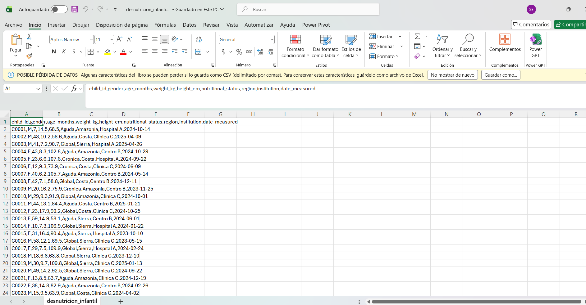

_Descripción: Captura del archivo `desnutricion_infantil.csv` con sus 9 columnas y los primeros registros._

---

## Diseño dimensional (modelo estrella)

<a id="figura-2"></a>

**Figura 2:** Modelo estrella en Power Pivot.

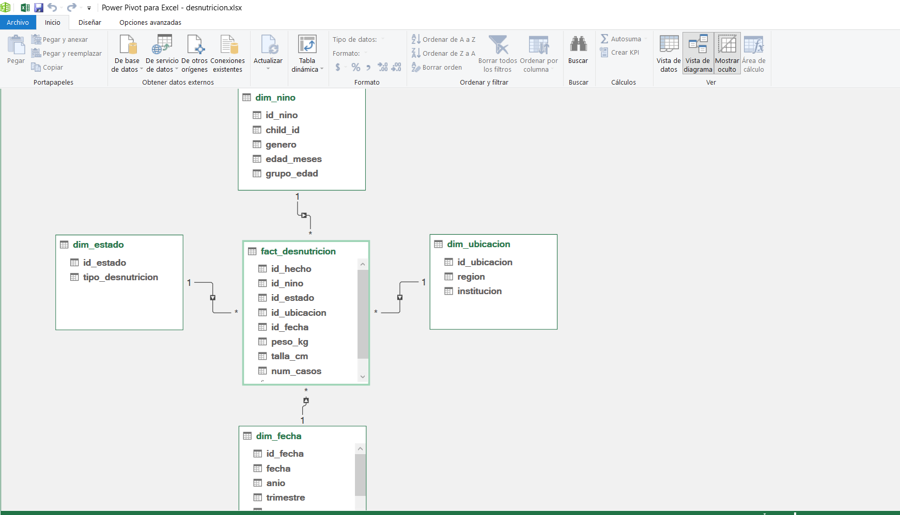

_Descripción: Vista de diagrama de Power Pivot. La tabla de hechos `fact_desnutricion` se ubica en el centro y se relaciona con las cuatro dimensiones mediante relaciones uno a muchos (1:\*)._

El modelo se compone de una tabla de hechos y cuatro dimensiones. Cada dimensión responde a una pregunta de análisis:

| Tabla | Tipo | Campos | Responde |
|---|---|---|---|
| `fact_desnutricion` | Hechos | `id_hecho`, `id_nino`, `id_estado`, `id_ubicacion`, `id_fecha`, `peso_kg`, `talla_cm`, `num_casos` | — |
| `dim_nino` | Dimensión | `id_nino`, `child_id`, `genero`, `edad_meses`, `grupo_edad` | ¿Edad y género? |
| `dim_estado` | Dimensión | `id_estado`, `tipo_desnutricion` | ¿Qué tipo? |
| `dim_ubicacion` | Dimensión | `id_ubicacion`, `region`, `institucion` | ¿Qué región? ¿Qué institución? |
| `dim_fecha` | Dimensión | `id_fecha`, `fecha`, `anio`, `trimestre`, `mes`, `dia` | ¿Cuándo? |

*   **`fact_desnutricion` (Tabla de hechos):**
    *   Registra cada caso atendido (un registro por niño o niña).
    *   Contiene las claves foráneas hacia las cuatro dimensiones y las medidas `peso_kg`, `talla_cm` y `num_casos`. Esta última vale 1 en cada registro, de modo que `SUM(num_casos)` devuelve el número de casos.
*   **`dim_nino` (Dimensión del niño):**
    *   Almacena el identificador original (`child_id`), el género en texto completo (`Masculino`/`Femenino`), la edad en meses y el grupo de edad derivado.
*   **`dim_estado` (Dimensión del estado nutricional):**
    *   Contiene los tres tipos de desnutrición registrados: `Aguda`, `Cronica` y `Global`.
*   **`dim_ubicacion` (Dimensión de ubicación):**
    *   Agrupa la región y la institución de atención. Sus 9 registros corresponden a las combinaciones de 3 regiones (Amazonía, Costa, Sierra) y 3 instituciones (Centro B, Clínica C, Hospital A).
*   **`dim_fecha` (Dimensión de tiempo):**
    *   Descompone la fecha de medición en año, trimestre, mes y día; contiene 353 fechas únicas.

---

## Problemas encontrados

### En los datos

- **Valores nulos y duplicados:** No se encontraron valores vacíos ni registros duplicados; cada `child_id` aparece una sola vez.
- **`gender`:** Está codificado como `M`/`F`, por lo que se transformó a `Masculino`/`Femenino` para que los reportes sean más legibles.
- **`age_months`:** La edad está registrada en meses (de 6 a 59) y no existe un campo de grupo de edad, necesario para analizar la variación de la desnutrición por edad.
- **`nutritional_status`:** Los valores están escritos sin tilde (`Cronica`). Además, todos los registros corresponden a niños con algún tipo de desnutrición; no existe la categoría `Normal`, por lo que no es posible calcular prevalencias, sino solo distribuciones de casos.
- **`region` e `institution`:** Las tres instituciones atienden casos en las tres regiones, por lo que la ubicación se modeló como la combinación región + institución.
- **`weight_kg` y `height_cm`:** Algunas combinaciones de edad, peso y talla son poco plausibles; por ejemplo, el registro `C0001` (7 meses) tiene 14,5 kg y 68,5 cm, y existen 30 niños mayores de 48 meses con tallas menores a 70 cm. Se conservaron los valores originales, ya que corregirlos requiere validación con la fuente.
- **`date_measured`:** Viene en formato `AAAA-MM-DD`, por lo que se configuró como tipo `Date` con formato `yyyy-MM-dd` en Pentaho.

### Durante la implementación

- **Ejecución repetida del Job:** Al ejecutar el Job por segunda vez se produjo el error `llave duplicada viola restricción de unicidad «dim_nino_child_id_key»`. Se solucionó vaciando las tablas con `TRUNCATE ... RESTART IDENTITY CASCADE` antes de una nueva carga.
- **Clave incorrecta en `fact_desnutricion`:** El paso *Stream lookup* `buscar nino_key` devolvía `child_id` renombrado como `id_nino`, lo que generó el error `la columna «id_nino» es de tipo integer pero la expresión es de tipo character varying`. Se corrigió configurando el campo a recuperar como `id_nino`.
- **Conector de PostgreSQL en Excel:** El conector requería componentes adicionales (Npgsql) no instalados, por lo que las tablas del DW se exportaron a CSV desde pgAdmin y se cargaron al Modelo de datos de Excel.
- **Exportación sin encabezado y separador decimal:** La primera exportación se realizó sin la opción *Header*, por lo que Excel mostró `Column1`, `Column2`, etc.; además, por la configuración regional en español, el peso `14.50` se leyó como `1450`. Se volvió a exportar con *Header* activado y se configuró la carga de datos con la configuración regional *Inglés (Estados Unidos)*.
- **Relación incorrecta en Power Pivot:** La relación de `dim_estado` se creó por error con `id_hecho` en lugar de `id_estado`, lo que produjo 497 casos *(en blanco)* en la tabla dinámica. Se corrigió desde *Diseñar → Administrar relaciones*.

---

## Transformaciones aplicadas

- **Staging:** El CSV se cargó sin cambios en la tabla temporal `stg_desnutricion`, con los tipos de dato `VARCHAR`, `INT`, `NUMERIC` y `DATE`.
- **`gender` → `genero`:** Se convirtió mediante `CASE gender WHEN 'M' THEN 'Masculino' ELSE 'Femenino' END`.
- **`grupo_edad`:** Se derivó a partir de `age_months` en cinco rangos por año de vida: `0-11 meses`, `12-23 meses`, `24-35 meses`, `36-47 meses` y `48-59 meses`.
- **`dim_estado` y `dim_ubicacion`:** Se obtuvieron los valores únicos mediante `SELECT DISTINCT`, generando 3 y 9 registros respectivamente.
- **`dim_fecha`:** A partir de `date_measured` se derivaron el año, trimestre, mes y día con `EXTRACT()`, generando 353 fechas únicas.
- **Claves sustitutas:** Todas las dimensiones usan claves `SERIAL` generadas por PostgreSQL, independientes de los identificadores originales.
- **`fact_desnutricion`:** Mediante pasos *Stream lookup* se reemplazaron los valores de texto (`child_id`, `nutritional_status`, `region` + `institution`, `date_measured`) por las claves de cada dimensión. Con *Select values* se conservaron solo las claves y medidas, y se renombraron `weight_kg` y `height_cm` a `peso_kg` y `talla_cm`. Se agregó la medida `num_casos = 1`.

---

## Implementación en PostgreSQL

Se creó la base de datos `dw_desnutricion` y se ejecutó el script [`01_DDL.sql`](Script-SQL/01_DDL.sql) en el Query Tool de pgAdmin. El script crea la tabla temporal `stg_desnutricion`, las cuatro dimensiones y la tabla de hechos. Esta última se crea al final, porque sus claves foráneas (`REFERENCES`) dependen de que las dimensiones existan.

<a id="figura-3"></a>

> **Figura 3:** Creación de tablas en PostgreSQL.
>
> 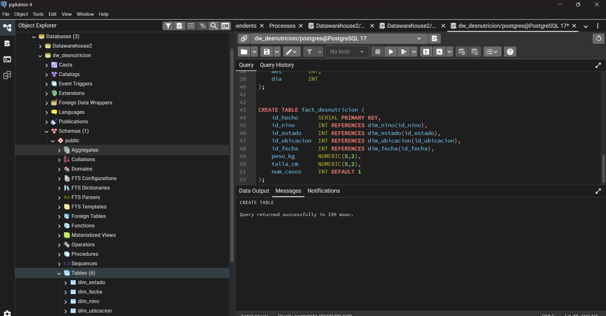
>
> _Descripción: Ejecución del script DDL en pgAdmin y verificación de las 6 tablas creadas en el esquema `public` de la base `dw_desnutricion`._

---

## Proceso ETL en Pentaho

El proceso ETL se desarrolló en **Pentaho Data Integration (Spoon) 10.2** con seis transformaciones y un Job, todos disponibles en la carpeta [`Pentaho/`](Pentaho/):

| Archivo | Fase | Pasos | Registros |
|---|---|---|---|
| `carga_staging.ktr` | Extracción | CSV file input → Table output | 500 |
| `dim_nino.ktr` | Transformación | Table input → Table output | 500 |
| `dim_estado.ktr` | Transformación | Table input → Table output | 3 |
| `dim_ubicacion.ktr` | Transformación | Table input → Table output | 9 |
| `dim_fecha.ktr` | Transformación | Table input → Table output | 353 |
| `fact_desnutricion.ktr` | Carga | Table input → 4 × Stream lookup → Select values → Table output | 500 |
| `job_dw_desnutricion.kjb` | Orquestación | Start → transformaciones en orden → Success | — |

<a id="figura-4"></a>

> **Figura 4:** Conexión de Pentaho a PostgreSQL.
>
> 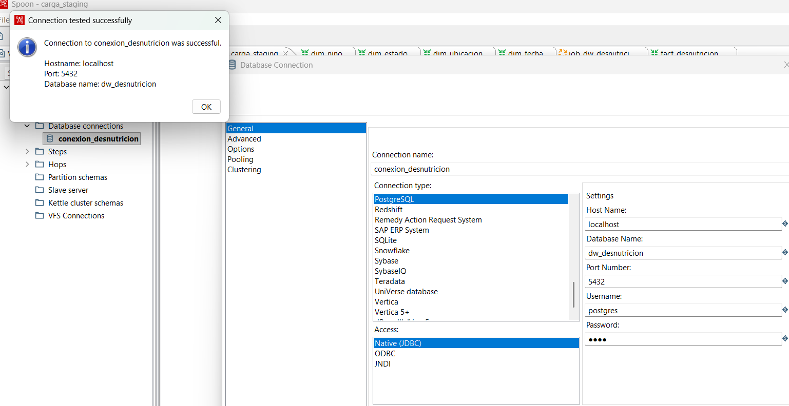
>
> _Descripción: Configuración de la conexión `conexion_desnutricion` (PostgreSQL, Native JDBC, `localhost:5432`, base `dw_desnutricion`) y prueba de conexión exitosa._

<a id="figura-5"></a>

> **Figura 5:** Transformación carga_staging.
>
> 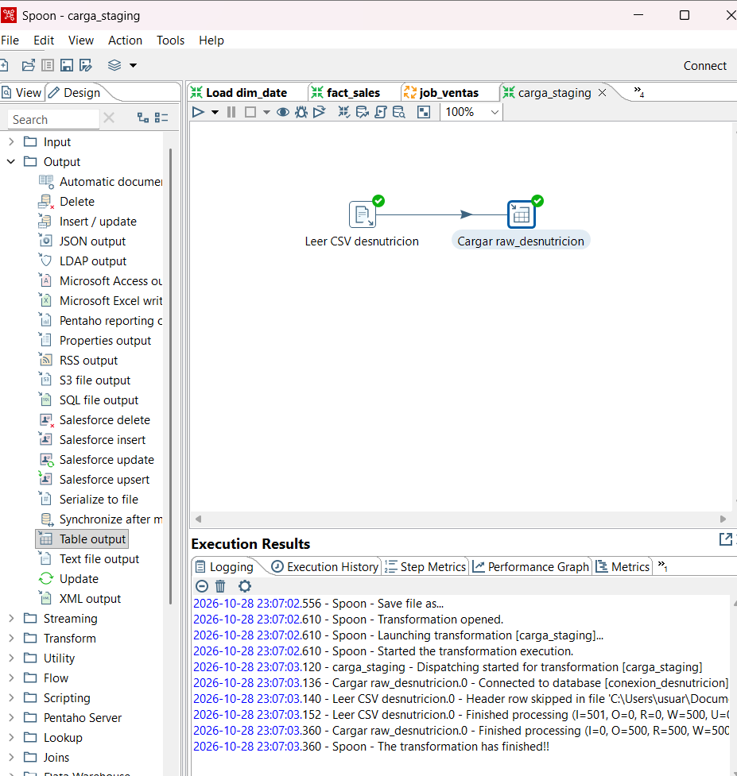
>
> _Descripción: Lectura del archivo CSV con delimitador `,`, encabezado activado y `date_measured` como tipo `Date` (`yyyy-MM-dd`); los 500 registros se cargan en la tabla de staging._

<a id="figura-6"></a>

> **Figura 6:** Transformación dim_nino.
>
> 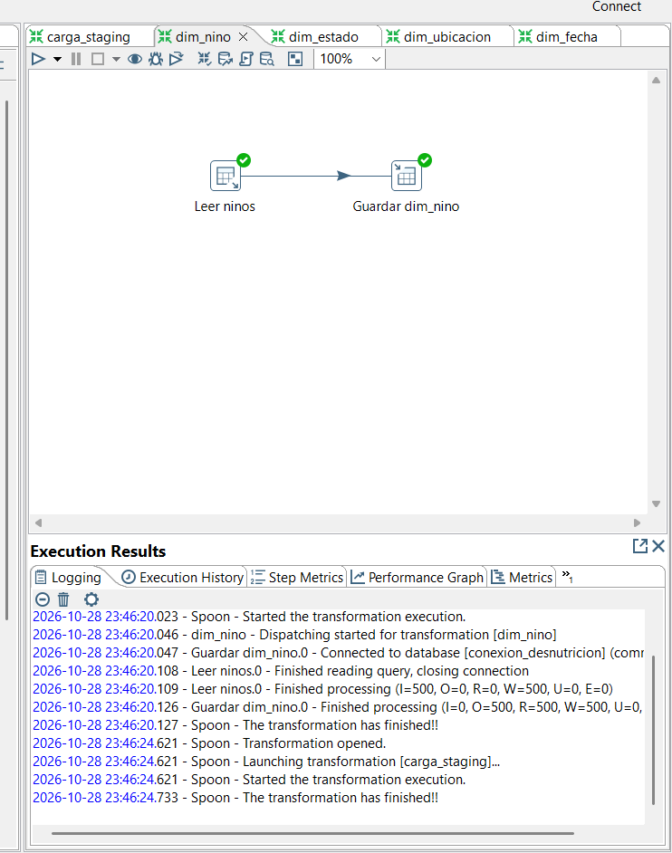
>
> _Descripción: Consulta que transforma el género y genera el grupo de edad; se cargan 500 niños en `dim_nino`._

<a id="figura-7"></a>

> **Figura 7:** Transformación dim_estado.
>
> 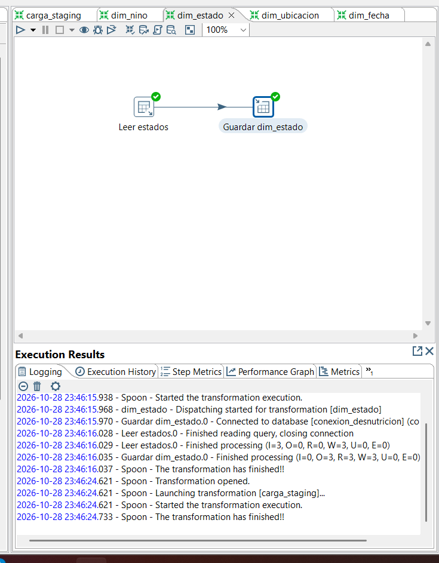
>
> _Descripción: Obtención de los 3 tipos de desnutrición únicos mediante `SELECT DISTINCT`._

<a id="figura-8"></a>

> **Figura 8:** Transformación dim_ubicacion.
>
> 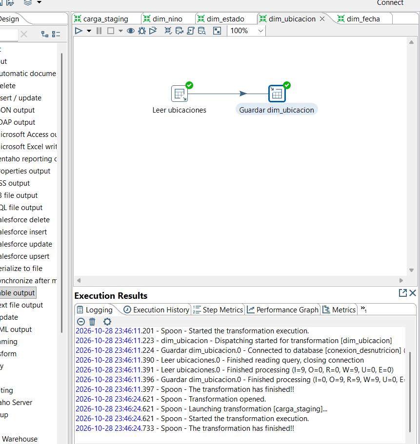
>
> _Descripción: Obtención de las 9 combinaciones únicas de región e institución._

<a id="figura-9"></a>

> **Figura 9:** Transformación dim_fecha.
>
> 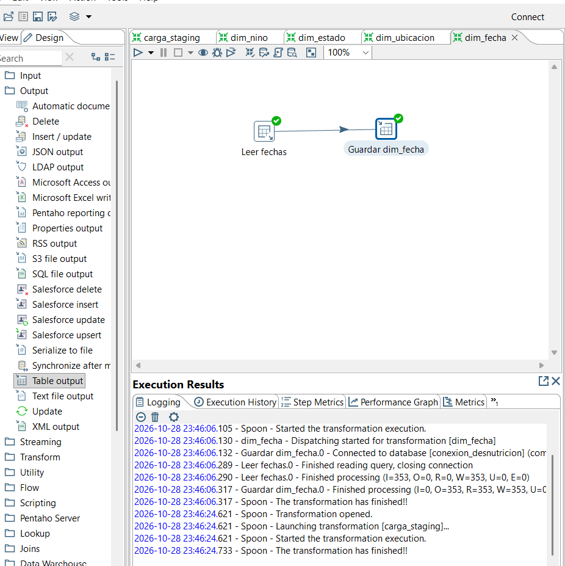
>
> _Descripción: Descomposición de las 353 fechas únicas en año, trimestre, mes y día mediante `EXTRACT()`._

<a id="figura-10"></a>

> **Figura 10:** Transformación fact_desnutricion.
>
> 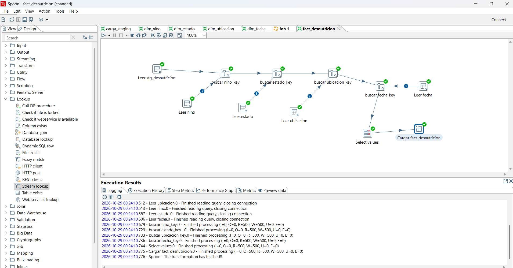
>
> _Descripción: El flujo principal lee la tabla de staging y, mediante cuatro pasos Stream lookup (`buscar nino_key`, `buscar estado_key`, `buscar ubicacion_key`, `buscar fecha_key`), obtiene las claves de cada dimensión. Select values deja solo las claves y medidas, y Table output inserta los 500 hechos._

<a id="figura-11"></a>

> **Figura 11:** Job job_dw_desnutricion.
>
> 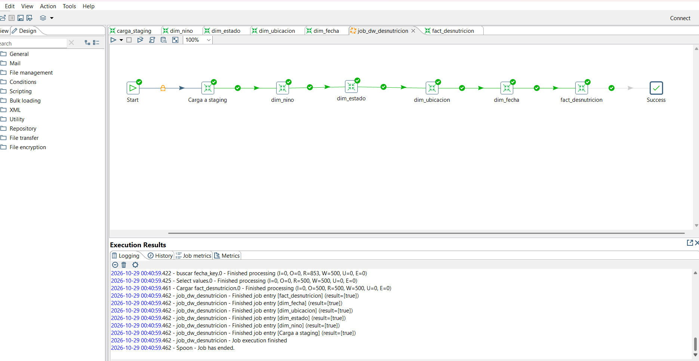
>
> _Descripción: Job que ejecuta en orden la carga de staging, las cuatro dimensiones y la tabla de hechos. Todas las entradas finalizan con éxito (`result=[true]`)._

<a id="figura-12"></a>

> **Figura 12:** Comprobación de la carga.
>
> 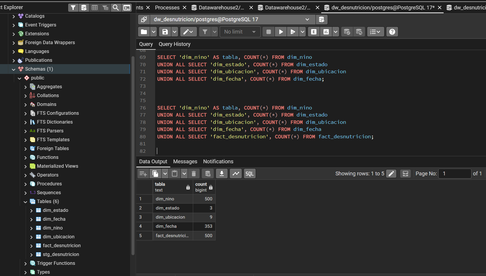
>
> _Descripción: Ejecución de [`02_comprobacion.sql`](Script-SQL/02_comprobacion.sql). Se verificaron 500 niños, 3 estados, 9 ubicaciones, 353 fechas y 500 hechos._

---

## Modelo estrella en Power Pivot

Las cinco tablas del DW (sin la tabla de staging) se exportaron a CSV desde pgAdmin (*Import/Export Data*, con encabezado activado) y se cargaron al **Modelo de datos** de Excel con la opción *Solo crear conexión*. En Power Pivot se crearon las relaciones de la [Figura 2](#figura-2) y la medida DAX:

```DAX
Total Casos := SUM(fact_desnutricion[num_casos])
```

El modelo y las tablas dinámicas se encuentran en [`PowerPivot/desnutricion.xlsx`](PowerPivot/desnutricion.xlsx).

<a id="figura-13"></a>

> **Figura 13:** Exportación de tablas a CSV.
>
> 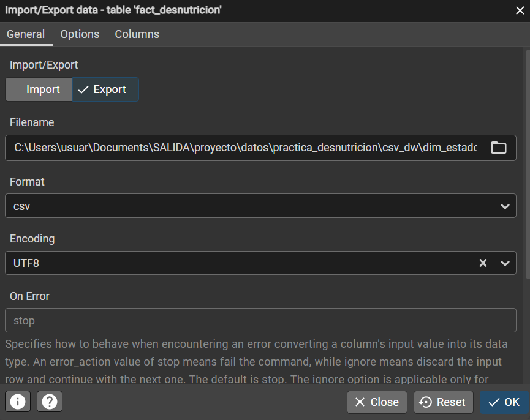
>
> _Descripción: Exportación de cada tabla desde pgAdmin con formato `csv`, codificación `UTF8` y la opción *Header* activada._

<a id="figura-14"></a>

> **Figura 14:** Tablas cargadas en el Modelo de datos.
>
> 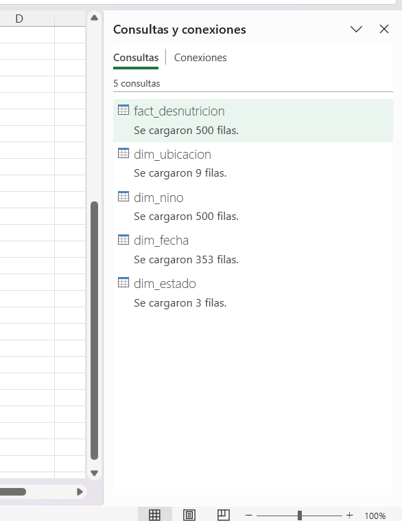
>
> _Descripción: Panel *Consultas y conexiones* con las 5 tablas cargadas: `fact_desnutricion` (500), `dim_nino` (500), `dim_estado` (3), `dim_ubicacion` (9) y `dim_fecha` (353)._

<a id="figura-15"></a>

> **Figura 15:** Medida Total Casos.
>
> 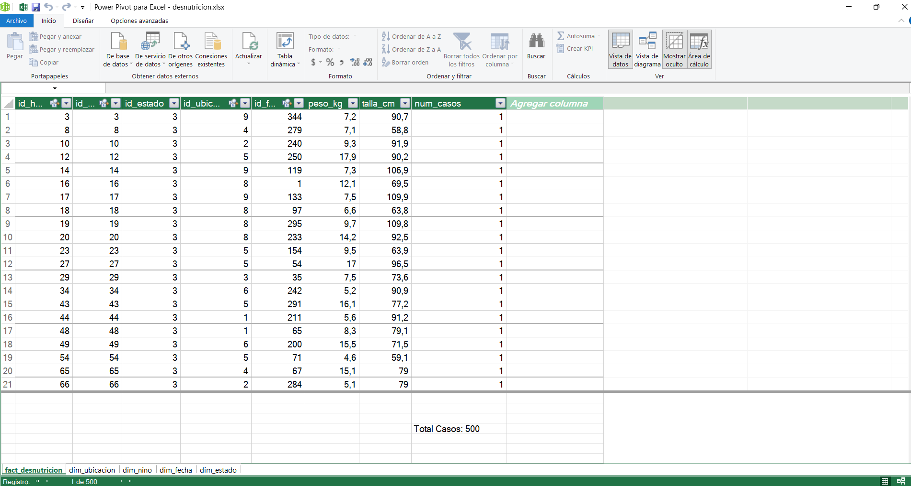
>
> _Descripción: Creación de la medida `Total Casos` en el área de cálculo de `fact_desnutricion`, con un resultado de 500._

---

## Consultas y respuestas a las preguntas

Cada pregunta se resolvió de dos formas: con SQL en PostgreSQL ([`03_consultas.sql`](Script-SQL/03_consultas.sql)) y con tablas dinámicas en Power Pivot. Ambas dieron los mismos resultados.

### Pregunta 1: ¿Cuál es el tipo de desnutrición más común por región?

<a id="figura-16"></a>

> **Figura 16:** Consulta 1
>
> 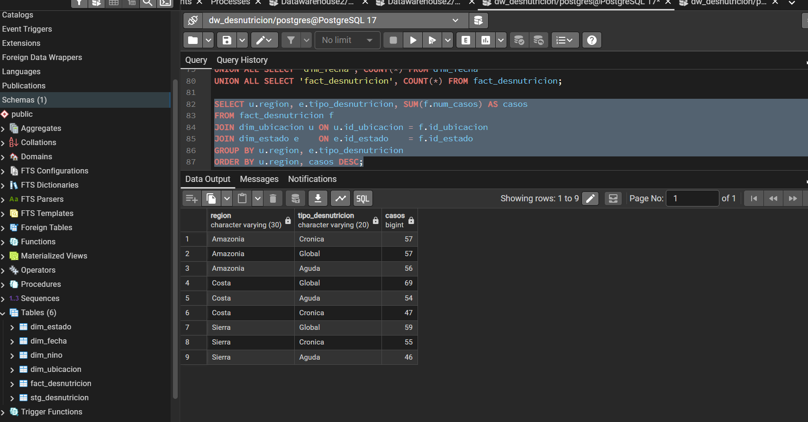
>
> *Lógica:* Se realizó un `JOIN` entre `fact_desnutricion`, `dim_ubicacion` y `dim_estado`, se agrupó por `region` y `tipo_desnutricion`, y se sumó `num_casos`, ordenando de mayor a menor dentro de cada región.

<a id="figura-17"></a>

> **Figura 17:** Tabla dinámica 1
>
> 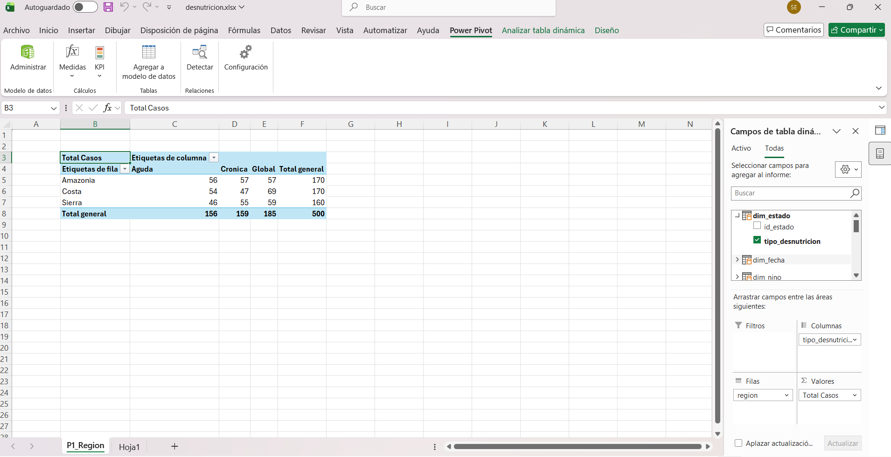
>
> _Descripción: Filas `region`, columnas `tipo_desnutricion` y valores `Total Casos`._

| Región | Aguda | Crónica | Global | Total | Más común |
|---|---|---|---|---|---|
| Amazonía | 56 | 57 | 57 | 170 | Crónica / Global (empate) |
| Costa | 54 | 47 | **69** | 170 | Global |
| Sierra | 46 | 55 | **59** | 160 | Global |
| **Total** | 156 | 159 | **185** | 500 | Global |

**Respuesta:** La desnutrición **global** es la más común, con 185 de los 500 casos (37 %). Predomina en la **Costa** (69 casos) y en la **Sierra** (59 casos). En la **Amazonía**, la desnutrición **crónica** y la **global** empatan con 57 casos cada una, y la aguda tiene 56, por lo que en esa región los tres tipos se presentan de forma casi equilibrada.

### Pregunta 2: ¿Cómo varía la desnutrición por edad y género?

<a id="figura-18"></a>

> **Figura 18:** Consulta 2
>
> 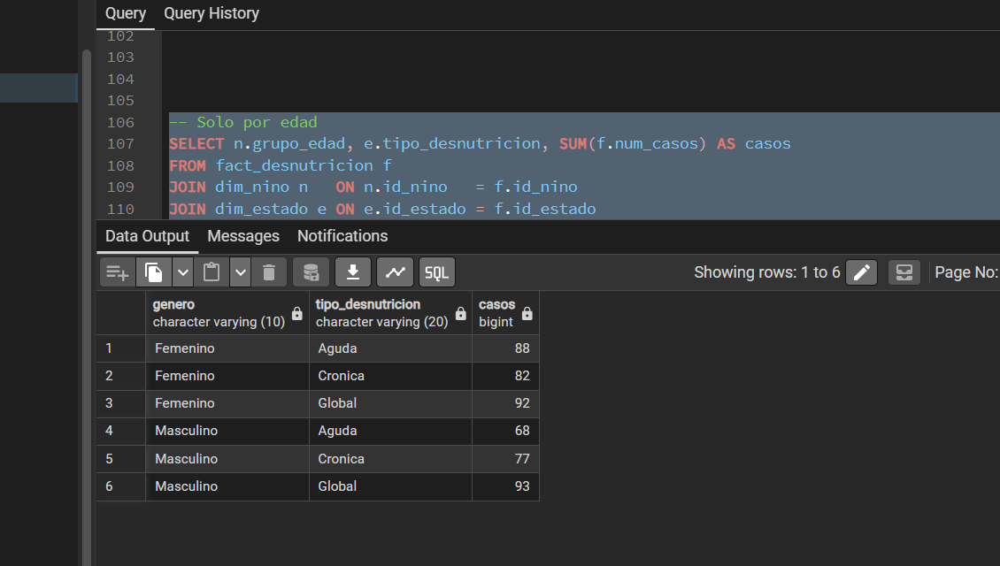
>
> *Lógica:* Se cruzaron `fact_desnutricion`, `dim_nino` y `dim_estado`, se agrupó por `grupo_edad`, `genero` y `tipo_desnutricion`, y se sumó `num_casos`.

<a id="figura-19"></a>

> **Figura 19:** Tabla dinámica 2
>
> 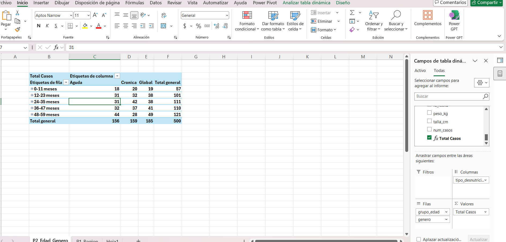
>
> _Descripción: Filas `grupo_edad` y `genero`, columnas `tipo_desnutricion` y valores `Total Casos`._

| Grupo de edad | Aguda | Crónica | Global | Total |
|---|---|---|---|---|
| 0-11 meses | 18 | 20 | 19 | 57 |
| 12-23 meses | 31 | 32 | 38 | 101 |
| 24-35 meses | 31 | **42** | 38 | 111 |
| 36-47 meses | 32 | 37 | 41 | 110 |
| 48-59 meses | **44** | 28 | **49** | 121 |

| Género | Aguda | Crónica | Global | Total |
|---|---|---|---|---|
| Femenino | **88** | 82 | 92 | 262 (52,4 %) |
| Masculino | 68 | 77 | **93** | 238 (47,6 %) |

**Respuesta:** Los casos **aumentan con la edad**: pasan de 57 en el grupo de 0-11 meses a 121 en el de 48-59 meses, que es el más afectado. La desnutrición **crónica** alcanza su máximo entre los 24 y 35 meses (42 casos), y la **aguda** sube notablemente entre los 48 y 59 meses (44 casos). Por género, las **niñas** presentan más casos (262, el 52,4 %) que los niños (238, el 47,6 %); la mayor diferencia está en la desnutrición **aguda** (88 casos en niñas frente a 68 en niños). En los **niños** predomina la desnutrición **global** (93 casos).

### Pregunta 3: ¿Qué instituciones atienden más casos?

<a id="figura-20"></a>

> **Figura 20:** Consulta 3
>
> 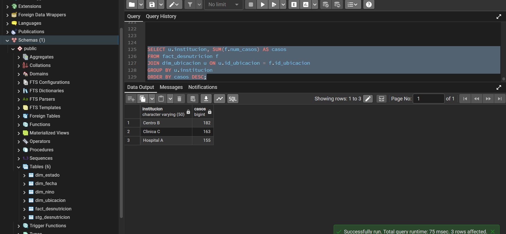
>
> *Lógica:* Se realizó un `JOIN` entre `fact_desnutricion` y `dim_ubicacion`, se agrupó por `institucion`, se sumó `num_casos` y se calculó el porcentaje sobre el total con una función de ventana (`SUM(...) OVER ()`).

<a id="figura-21"></a>

> **Figura 21:** Tabla dinámica 3
>
> 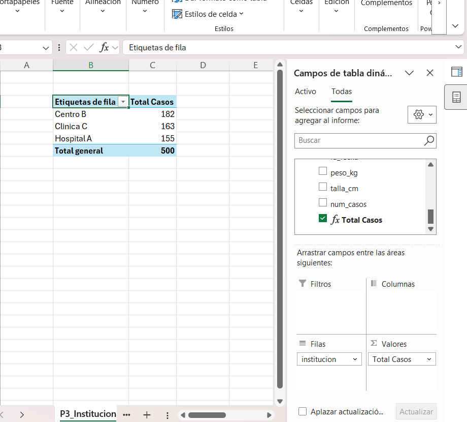
>
> _Descripción: Filas `institucion` y valores `Total Casos`, ordenados de mayor a menor._

| Posición | Institución | Casos | % |
|---|---|---|---|
| 1 | **Centro B** | **182** | 36,4 % |
| 2 | Clínica C | 163 | 32,6 % |
| 3 | Hospital A | 155 | 31,0 % |

**Respuesta:** **Centro B** es la institución que atiende más casos, con 182 de los 500 registros (36,4 %). Le siguen **Clínica C**, con 163 casos (32,6 %), y **Hospital A**, con 155 casos (31,0 %).

---

## Conclusiones

- El esquema estrella, con una tabla de hechos y cuatro dimensiones, permitió responder las tres preguntas de negocio con consultas simples: basta unir la tabla de hechos con las dimensiones necesarias y sumar `num_casos`.
- Pentaho Data Integration automatizó el proceso ETL completo. La separación en transformaciones (staging, dimensiones y hechos) y su orquestación en un Job facilitan identificar en qué fase ocurre un error y volver a ejecutar la carga.
- El paso *Stream lookup* permitió sustituir los valores de texto por las claves sustitutas de cada dimensión sin escribir `JOIN` en SQL. Es necesario verificar que el campo recuperado sea la clave (`id_nino`) y no el campo de búsqueda (`child_id`).
- En Power Pivot, la aparición de valores *(en blanco)* en una tabla dinámica indica una relación mal definida, por lo que conviene revisar las relaciones en *Administrar relaciones* antes de interpretar los resultados.
- La desnutrición global es el tipo más frecuente, los casos aumentan con la edad, las niñas presentan más casos de desnutrición aguda y Centro B es la institución con mayor carga de atención.

---

## Referencias bibliográficas

[1] Escuela Politécnica Nacional, "Creación Data Warehouse", Aula Virtual EPN, Facultad de Ingeniería de Sistemas, 2026.

[2] R. Kimball y M. Ross, *The Data Warehouse Toolkit: The Definitive Guide to Dimensional Modeling*, 3.ª ed. Indianapolis, IN, USA: Wiley, 2013.

## Declaración de uso de IA

Se declara formalmente que el porcentaje de uso de herramientas de inteligencia artificial generativa para la estructuración, redacción y corrección de estilo de este informe ha sido del **20 %**. La IA se utilizó como apoyo para la redacción y el formato Markdown, mientras que la implementación en PostgreSQL, el desarrollo del proceso ETL en Pentaho, la construcción del modelo en Power Pivot, las capturas de pantalla y la resolución de los problemas encontrados son producto del trabajo de los integrantes del grupo.

---

[1]: https://github.com/JonathanGuaman2004/Proceso-ETL.git
