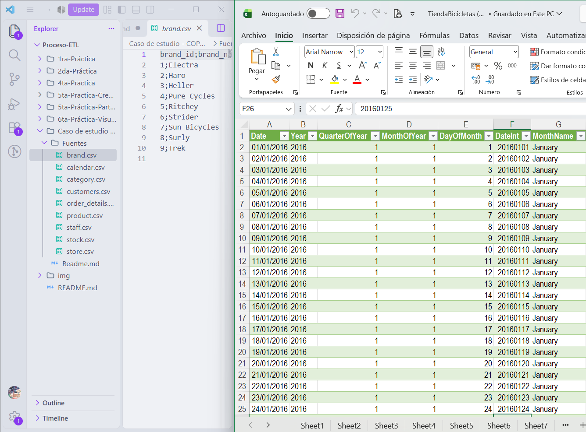
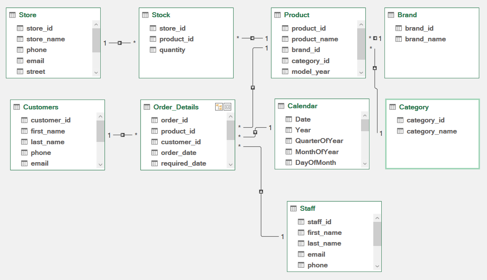
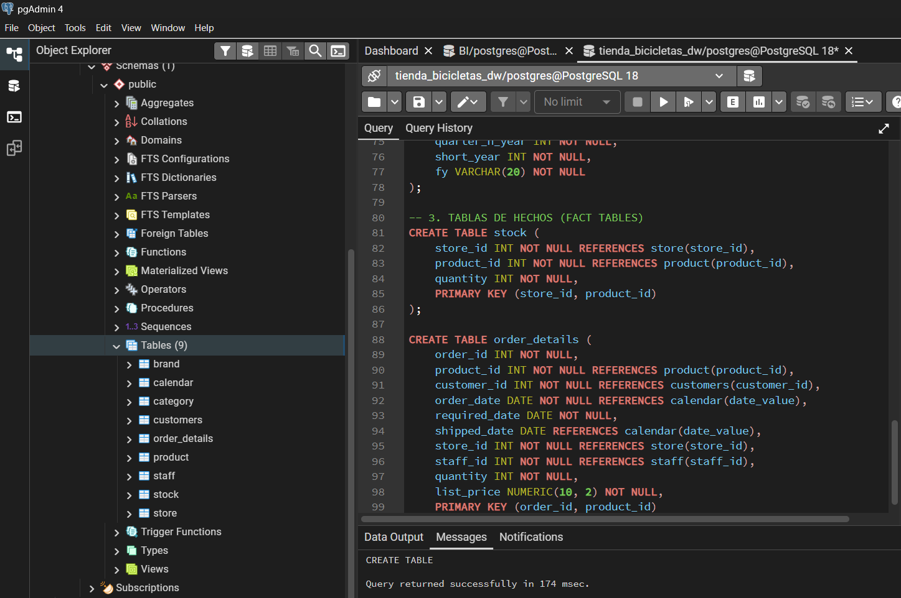
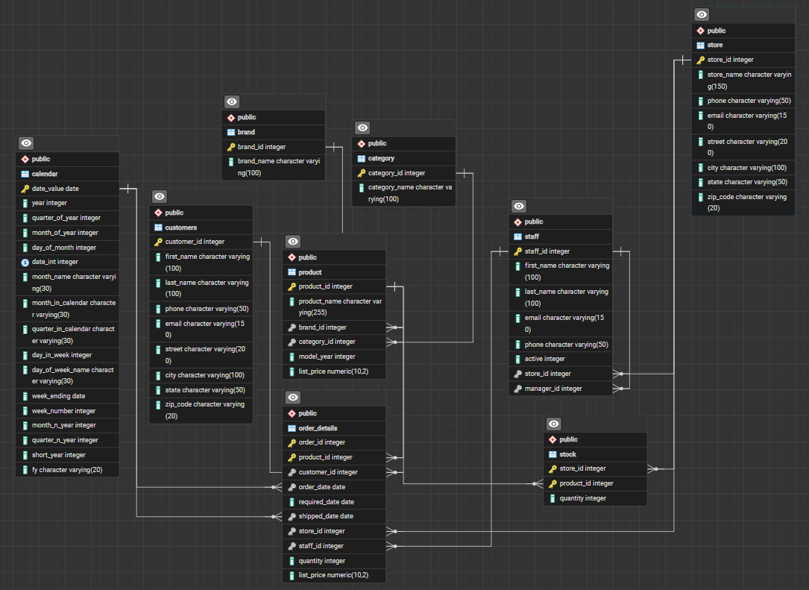
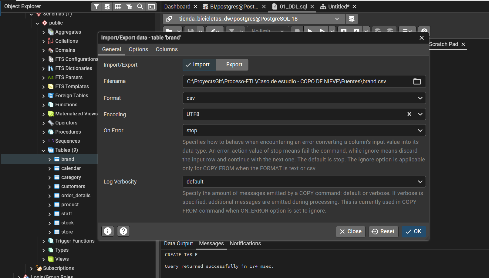
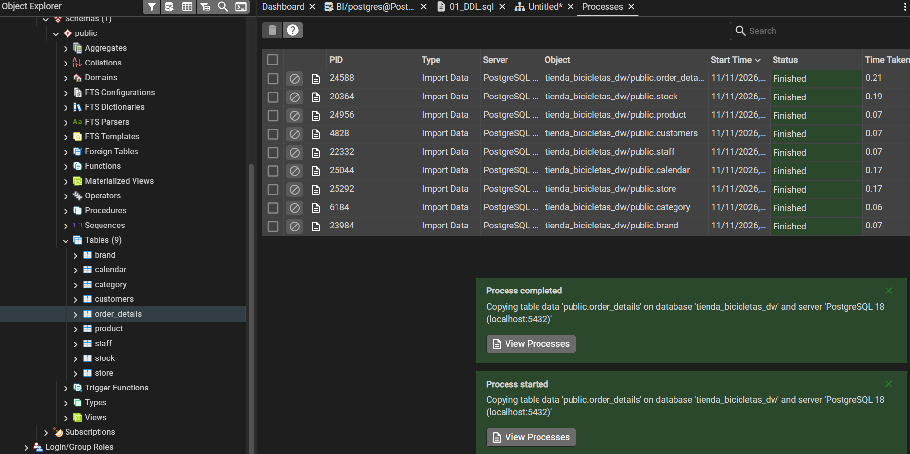
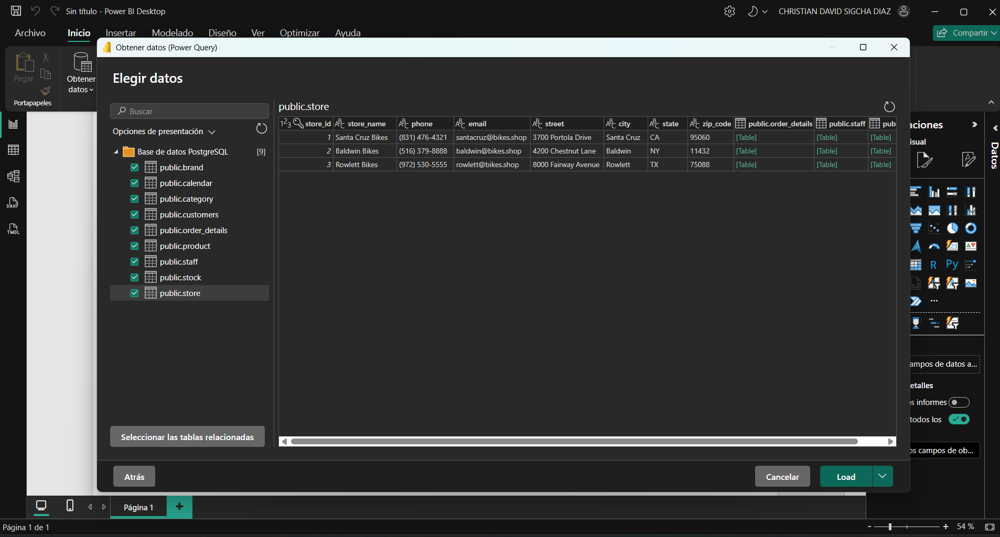
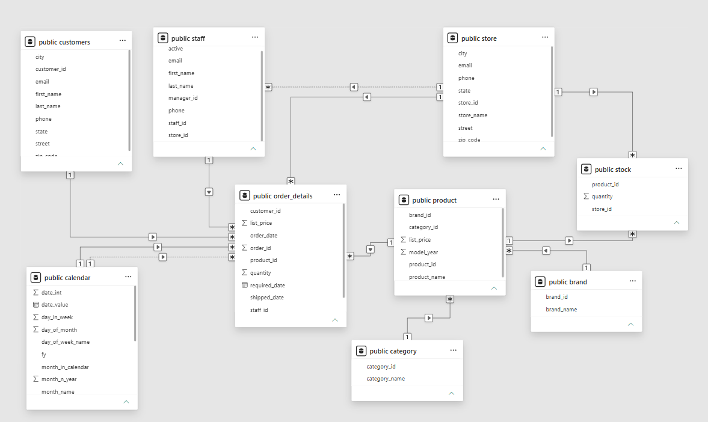
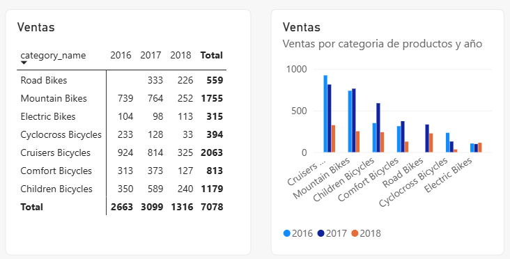

  <!-- Encabezado institucional -->
  

  
<h1 style="color: #FFFFFF; font-size: 25px; margin: 20px 0 8px;">
      ESCUELA POLITÉCNICA NACIONAL
    </h1>

      Facultad de Ingeniería en Sistemas
    

  

  <!-- Línea institucional -->
  

  <!-- Información académica -->
  

      INFORME ACADÉMICO - CASO DE ESTUDIO
    

<h2 style="color: #0C233F; font-size: 28px; margin: 20px 0;">
      MODELO DIMENSIONAL COPO DE NIEVE EN POSTGRESQL Y POWER BI
    </h2>

      <strong>Materia:</strong> Business Intelligence 
      <strong>Paralelo:</strong> GR2SW_2026-B 
      <strong>Fecha:</strong> 11 de noviembre de 2026
    

 

<!-- Integrantes -->

<h3 style="color: #0C233F; font-size: 17px; margin-top: 0;">
        INTEGRANTES
      </h3>

        Guamán Maza Jonathan Steven 
        Jarrin Román Helen Scarleth 
        Maldonado Simbaña Shirley Estefani 
        Sigcha Diaz Christian David
      

  

  <!-- Pie decorativo -->
  

---

**[Enlace al repositorio de GitHub][1]**

---

## Índice

### Contenido

1. [Objetivos](#objetivos)
   - [Objetivo general](#objetivo-general)
   - [Objetivos específicos](#objetivos-específicos)
2. [Fuentes de datos](#fuentes-de-datos)
3. [Diseño dimensional (Copo de Nieve)](#diseño-dimensional-copo-de-nieve)
4. [Análisis de la estructura de los datos](#análisis-de-la-estructura-de-los-datos)
5. [Preparación y mapeo de entidades](#preparación-y-mapeo-de-entidades)
6. [Configuración de carga en PostgreSQL](#configuración-de-carga-en-postgresql)
7. [Importación y Consulta en Power BI - Resultado](#importación-y-consulta-en-power-bi---resultado)
8. [Conclusiones](#conclusiones)
9. [Referencias bibliográficas](#referencias-bibliográficas)
10. [Declaración de uso de IA](#declaración-de-uso-de-ia)

### Índice de figuras

- [Figura 1. Archivo fuente original TiendaBicicletas.xlsx](#figura-1)
- [Figura 2. Diagrama del modelo Copo de Nieve en Power Pivot](#figura-2)
- [Figura 3. Creación de tablas del modelo Copo de Nieve en PostgreSQL](#figura-3)
- [Figura 4. Diagrama Entidad-Relación (ERD) en pgAdmin 4](#figura-4)
- [Figura 5. Configuración de importación de datos en pgAdmin](#figura-5)
- [Figura 6. Importación completa](#figura-6)
- [Figura 7. Conexión de Power BI Desktop a PostgreSQL](#figura-7)
- [Figura 8. Modelo relacional Copo de Nieve en Power BI](#figura-8)
- [Figura 9. Consulta en Power BI: Cantidad de productos vendidos por categoría y años](#figura-9)

---

## Objetivos

### Objetivo general

- Implementar un modelo dimensional físico bajo el esquema Copo de Nieve (*Snowflake Schema*) en PostgreSQL a partir de los datos del archivo `TiendaBicicletas.xlsx`, e importarlo hacia Power BI Desktop para consultar y visualizar la cantidad de productos vendidos por categoría y años.

### Objetivos específicos

- Identificar y mapear las 9 hojas del archivo `TiendaBicicletas.xlsx` hacia sus respectivas tablas de hechos, dimensiones de primer nivel y sub-dimensiones normalizadas de segundo nivel.
- Construir el esquema físico Copo de Nieve en PostgreSQL definiendo las relaciones de integridad referencial (claves primarias y foráneas) entre todas las tablas del modelo.
- Poblar las tablas del modelo en PostgreSQL utilizando la herramienta *Import/Export Data* de pgAdmin 4 respetando el orden jerárquico de las dimensiones.
- Importar el modelo físico desde PostgreSQL hacia Power BI Desktop, verificar las relaciones del esquema Copo de Nieve y consultar la cantidad de productos vendidos por categoría y años.

---

## Fuentes de datos

Se utilizó el archivo [`TiendaBicicletas.xlsx`](Fuentes/TiendaBicicletas.xlsx), proporcionado para el caso de estudio. El libro de Excel contiene 9 hojas de cálculo (`Sheet1` a `Sheet8` y `Calendar`) con la información maestra y transaccional ya estructurada de una empresa dedicada a la comercialización de bicicletas durante los años 2016, 2017 y 2018.

**Figura 1:** Archivo fuente original TiendaBicicletas.xlsx.

_Descripción: Captura de pantalla del archivo fuente `TiendaBicicletas.xlsx` y las 9 hojas exportadas a formato `.csv` para su importación en PostgreSQL._

---

## Diseño dimensional (Copo de Nieve)

**Figura 2:** Diagrama del modelo Copo de Nieve en Power Pivot.

_Descripción: Diseño de referencia del modelo dimensional Copo de Nieve (`Bike Store.xlsx`). Se observa la normalización de la dimensión `Product` hacia las sub-dimensiones `Brand` y `Category`, así como su relación con las tablas de hechos `Order_Details` y `Stock`._

El modelo **Copo de Nieve (*Snowflake Schema*)** es una variante del modelo dimensional en la que una o más dimensiones se normalizan en múltiples tablas relacionadas para eliminar la redundancia de atributos jerárquicos o descriptivos. El diseño consta de 9 entidades distribuidas en tres niveles:

*   **Tablas de Hechos (*Fact Tables*):**
    *   **`order_details` (Hechos de Ventas - `Sheet5`):** Registra las 4,722 transacciones detalladas de ventas. Contiene las métricas cuantitativas (`quantity`, `list_price`), las fechas operativas (`order_date`, `required_date`, `shipped_date`) y las claves foráneas que la vinculan con `product`, `customers`, `store`, `staff` y `calendar`.
    *   **`stock` (Hechos de Inventario - `Sheet2`):** Almacena 939 registros con la existencia en inventario (`quantity`) por cada sucursal (`store_id`) y producto (`product_id`).
*   **Dimensiones de Nivel 1 (Conectadas directamente a las tablas de hechos):**
    *   **`product` (`Sheet4`):** Agrupa los 321 productos del catálogo (`product_id`, `product_name`, `model_year`, `list_price`) y se ramifica mediante las claves foráneas `brand_id` y `category_id`.
    *   **`customers` (`Sheet6`):** Registra los datos de contacto y ubicación de los 1,445 clientes (`customer_id`, `first_name`, `last_name`, `phone`, `email`, `street`, `city`, `state`, `zip_code`).
    *   **`store` (`Sheet8`):** Contiene las 3 sucursales de la empresa (`Santa Cruz Bikes`, `Baldwin Bikes` y `Rowlett Bikes`).
    *   **`staff` (`Sheet3`):** Almacena la información de los 10 empleados (`staff_id`, `first_name`, `last_name`, `email`, `phone`, `active`, `store_id`, `manager_id`).
    *   **`calendar` (`Calendar`):** Dimensión de tiempo con 1,095 fechas (`2016-01-01` a `2018-12-30`) y 17 atributos jerárquicos (`year`, `quarter_of_year`, `month_name`, `date_int`, `fy`, entre otros).
*   **Sub-dimensiones de Nivel 2 (Ramificación Copo de Nieve):**
    *   **`brand` (`Sheet1`):** Catálogo normalizado con las 9 marcas de bicicletas (`brand_id`, `brand_name`).
    *   **`category` (`Sheet7`):** Catálogo normalizado con las 7 categorías de productos (`category_id`, `category_name`).

---

## Análisis de la estructura de los datos

Dado que los datos provienen de un esquema relacional previamente depurado, se analizaron sus particularidades estructurales para definir correctamente las restricciones del modelo físico en PostgreSQL:

- **Correspondencia de hojas genéricas:** Las primeras 8 pestañas del archivo `TiendaBicicletas.xlsx` tienen nombres genéricos (`Sheet1` a `Sheet8`), por lo que se inspeccionaron sus encabezados para identificar su entidad correspondiente: `Sheet1` (`brand`), `Sheet2` (`stock`), `Sheet3` (`staff`), `Sheet4` (`product`), `Sheet5` (`order_details`), `Sheet6` (`customers`), `Sheet7` (`category`) y `Sheet8` (`store`).
- **Atributos con valores nulos permitidos (`NULL`):**
  - En `order_details` (`Sheet5`), la columna `shipped_date` registra **508 valores vacíos**, correspondientes a órdenes emitidas que aún no han sido despachadas, mientras que `order_date` está completo en las 4,722 filas.
  - En `customers` (`Sheet6`), el campo `phone` es opcional y presenta 1,267 registros vacíos.
  - En `staff` (`Sheet3`), el campo `manager_id` es nulo únicamente en el primer registro (`staff_id = 1`, *Fabiola Jackson*), quien ocupa la gerencia general sin un supervisor superior.
- **Claves primarias compuestas en tablas de hechos:** En `order_details`, un mismo pedido (`order_id`) puede incluir varios artículos, por lo que la clave primaria se definió mediante el par `(order_id, product_id)`. De forma análoga, en `stock` se definió la clave primaria compuesta `(store_id, product_id)`.

---

## Preparación y mapeo de entidades

Para cargar las 9 hojas hacia PostgreSQL desde pgAdmin 4, se realizaron las siguientes configuraciones:

- **Exportación a formato CSV:** Cada hoja del archivo `TiendaBicicletas.xlsx` se guardó como un archivo `.csv` independiente con codificación `UTF-8` (`brand.csv`, `category.csv`, `store.csv`, `product.csv`, `customers.csv`, `staff.csv`, `calendar.csv`, `stock.csv` y `order_details.csv`).
- **Definición de tipos de datos en SQL (`01_DDL.sql`):**
  - Los identificadores (`brand_id`, `category_id`, `product_id`, `store_id`, `staff_id`, `customer_id`, `order_id`) y cantidades (`quantity`, `model_year`, `year`) se definieron como `INT`.
  - Los precios unitarios y de lista (`list_price`) se establecieron como `NUMERIC(10, 2)`.
  - Las columnas de fecha (`order_date`, `required_date`, `shipped_date`, `date_value`, `week_ending`) se declararon con el tipo `DATE`.
  - Los encabezados de la hoja `Calendar` se adaptaron al formato `snake_case` en PostgreSQL (por ejemplo, `Week Number` $\rightarrow$ `week_number`).

---

## Configuración de carga en PostgreSQL

El proceso de construcción y carga del modelo Copo de Nieve se llevó a cabo utilizando **pgAdmin 4** sobre la base de datos PostgreSQL en tres fases:

1. **Creación de estructuras (DDL):** Se ejecutó el script `01_DDL.sql` en el *Query Tool* de pgAdmin 4. Para respetar la integridad referencial del esquema Copo de Nieve, se crearon primero las sub-dimensiones de nivel 2 (`brand`, `category`), seguidas por las dimensiones de nivel 1 (`store`, `product`, `customers`, `staff`, `calendar`) y finalmente las tablas de hechos (`stock`, `order_details`).
2. **Validación del esquema físico (ERD):** Mediante la herramienta *ERD For Database* de pgAdmin 4 se comprobó visualmente la estructura del modelo Copo de Nieve y sus relaciones de clave foránea.
3. **Importación jerárquica de archivos CSV:** Utilizando la herramienta *Import/Export Data* de pgAdmin 4, se poblaron las tablas siguiendo el mismo orden jerárquico (Nivel 2 $\rightarrow$ Nivel 1 $\rightarrow$ Hechos), configurando la codificación en `UTF-8` y activando la opción *Header* para omitir la primera fila de encabezados.

> **Figura 3:** Creación de tablas del modelo Copo de Nieve en PostgreSQL.
>
> 
>
> _Descripción: Ejecución del script `01_DDL.sql` en el Query Tool de pgAdmin 4 para la creación de las 9 tablas que integran el modelo Copo de Nieve._

> **Figura 4:** Diagrama Entidad-Relación (ERD) en pgAdmin 4.
>
> 
>
> _Descripción: Diagrama físico Entidad-Relación generado en pgAdmin 4 donde se aprecia la estructura en Copo de Nieve de la base de datos._

> **Figura 5:** Configuración de importación de datos en pgAdmin.
>
> 
>
> _Descripción: Configuración de la interfaz Import/Export Data en pgAdmin 4 especificando el formato CSV, codificación UTF-8 y la opción Header activada._

> **Figura 6:** Importación completa.
>
> 
>
> _Descripción: Mensaje de confirmación (Notificación) de pgAdmin 4 indicando que el proceso de copiado de datos desde los archivos CSV hacia las tablas del modelo Copo de Nieve finalizó exitosamente._

---

## Importación y Consulta en Power BI - Resultado

Una vez cargados los datos en PostgreSQL, se abrió **Power BI Desktop** y se utilizó el conector nativo **Base de datos PostgreSQL**, ingresando el servidor `localhost` y la base de datos `tienda_bicicletas_dw` bajo el modo de conectividad *Importar*.

> **Figura 7:** Conexión de Power BI Desktop a PostgreSQL.
>
> 
>
> _Descripción: Selección y vista previa de las 9 tablas del modelo Copo de Nieve en el Navegador de Power BI Desktop conectadas directamente desde PostgreSQL._

> **Figura 8:** Modelo relacional Copo de Nieve en Power BI.
>
> 
>
> _Descripción: Vista de Modelo en Power BI Desktop donde se observan las relaciones 1 a muchos (`1:*`) propagándose desde las sub-dimensiones `brand` y `category` hacia `product`, y desde `product` y las demás dimensiones hacia `order_details` y `stock`._

### Consulta: Cantidad de productos vendidos por categoría y años

Para responder a la consulta del caso de estudio, en la *Vista de Informe* de Power BI se construyó una **Matriz** y un **Gráfico de columnas agrupadas** empleando los siguientes campos del modelo:
- **Filas / Eje X:** `category[category_name]` (Sub-dimensión de Nivel 2).
- **Columnas / Leyenda:** `calendar[year]` (Dimensión de Tiempo).
- **Valores / Eje Y:** `Suma de order_details[quantity]` (Tabla de Hechos).

A continuación, se detallan los valores obtenidos en Power BI (mostrando tanto el total de productos vendidos según la fecha de orden `order_date` como el total de productos despachados según `shipped_date`):

| Categoría (`category_name`) | 2016 | 2017 | 2018 | Total Vendido (`order_date`) | |
| :--- | :---: | :---: | :---: | :---: | :---: |
| **Cruisers Bicycles** |  | 814 | 325 | **2,063** | |
| **Mountain Bikes** | 739 | 764 | 252 | **1,755** | |
| **Children Bicycles** | 350 | 589 | 240 | **1,179** |  |
| **Comfort Bicycles** | 313 | 373 | 127 | **813** |  |
| **Road Bikes** | 0 | 333 | 226 | **559** |  |
| **Cyclocross Bicycles** | 233 | 128 | 33 | **394** |  |
| **Electric Bikes** | 104 | 98 | 113 | **315** | |
| **Total General** | **2,663** | **3,099** | **1,316** | **7,078** |  |

> **Figura 9:** Consulta en Power BI: Cantidad de productos vendidos por categoría y años.
>
> 
>
> *Lógica:* En el modelo Copo de Nieve, Power BI propaga el contexto de filtro desde la sub-dimensión `category` hacia la dimensión intermedia `product` (`category_id`), y desde `product` hacia la tabla de hechos `order_details` (`product_id`), agrupando la suma de `quantity` por cada categoría y por el año de la dimensión `calendar`.
>
> _Descripción: Reporte en Power BI que muestra la matriz resumen y el gráfico comparativo de la cantidad de productos vendidos por categoría y años (2016–2018)._

---

## Conclusiones

- La construcción del modelo **Copo de Nieve (*Snowflake Schema*)** en PostgreSQL permitió estructurar de manera óptima las 9 hojas del archivo `TiendaBicicletas.xlsx`, normalizando las marcas (`brand`) y categorías (`category`) en sub-dimensiones de segundo nivel para evitar la redundancia de textos en la dimensión `product`.
- Durante el proceso de carga con la herramienta *Import/Export Data* de pgAdmin 4 se evidenció que, en un esquema Copo de Nieve con llaves foráneas activas, es indispensable poblar primero las sub-dimensiones de nivel más externo (`brand` y `category`), luego las dimensiones principales (`product`, `store`, `customers`, `staff`, `calendar`) y finalmente las tablas de hechos (`stock` y `order_details`).
- La importación del modelo desde PostgreSQL hacia **Power BI Desktop** conservó de forma nativa las relaciones definidas en el script DDL, permitiendo atravesar la jerarquía `category` $\rightarrow$ `product` $\rightarrow$ `order_details` de manera transparente para el usuario final.
- El análisis por categoría y año reveló un total de **7,078 bicicletas vendidas** , siendo **2017 el año de mayores ventas con 3,099 unidades** y consolidándose **Cruisers Bicycles (2,063 unidades)** y **Mountain Bikes (1,755 unidades)** como las categorías más vendidas del negocio.

---

## Referencias bibliográficas

[1] Escuela Politécnica Nacional, "Caso de Estudio: Modelo Copo de Nieve en PostgreSQL y Power BI", Facultad de Ingeniería en Sistemas, 2026.

## Declaración de uso de IA

Se declara formalmente que el porcentaje de uso de herramientas de inteligencia artificial generativa para la estructuración, redacción y corrección de estilo ortotipográfico de este informe ha sido del **20 %**. La IA se utilizó como apoyo para la redacción y el formato Markdown, mientras que el análisis técnico, la creación del modelo en PostgreSQL, la integración y visualización en Power BI, y las capturas de pantalla son producto del trabajo intelectual de los integrantes del grupo.

---

[1]: https://github.com/JonathanGuaman2004/Proceso-ETL.git