<div align="center" style="font-family: Arial, Helvetica, sans-serif; color: #0C233F; max-width: 900px; margin: 0 auto;">

  <!-- Encabezado institucional -->
  <div style="background-color: #0C233F; padding: 32px 20px; border-radius: 8px 8px 0 0;">
  
<h1 style="color: #FFFFFF; font-size: 25px; margin: 20px 0 8px;">
      ESCUELA POLITÉCNICA NACIONAL
    </h1>
<p style="color: #DBD49A; font-size: 17px; margin: 0;">
      Facultad de Ingeniería en Sistemas
    </p>

  </div>

  <!-- Línea institucional -->
  <div style="height: 5px; background-color: #E22726;"></div>

  <!-- Información académica -->
  <div style="padding: 38px 24px 28px; border: 1px solid #E2E8F0; border-top: none;">

<p style="color: #E22726; font-size: 13px; font-weight: bold; letter-spacing: 2px;">
      INFORME ACADÉMICO - CASO DE ESTUDIO
    </p>

<div style="width: 65px; height: 3px; background-color: #F4BC47; margin: 18px auto;"></div>

<h2 style="color: #0C233F; font-size: 28px; margin: 20px 0;">
      MODELO DIMENSIONAL CONSTELACIÓN
    </h2>

<p style="font-size: 16px; color: #475569;">
      <strong>Materia:</strong> Business Intelligence<br>
      <strong>Paralelo:</strong> GR2SW_2026-B<br>
      <strong>Fecha:</strong> 18 de noviembre de 2026
    </p>

<br>

<!-- Integrantes -->
<div style="background-color: #F7F5E9; border-left: 4px solid #F4BC47; padding: 20px; margin: 10px auto; max-width: 520px;">

<h3 style="color: #0C233F; font-size: 17px; margin-top: 0;">
        INTEGRANTES
      </h3>

<p style="color: #334155; line-height: 1.9; margin-bottom: 0;">
        Guamán Maza Jonathan Steven<br>
        Jarrin Román Helen Scarleth<br>
        Maldonado Simbaña Shirley Estefani<br>
        Sigcha Diaz Christian David
      </p>

</div>

  </div>

  <!-- Pie decorativo -->
  <div style="height: 4px; background-color: #F4BC47;"></div>

</div>

---

**[Enlace al repositorio de GitHub][1]** · **[Enlace al dashboard en Power BI][2]**

---

## Índice

### Contenido

1. [Objetivos](#objetivos)
   - [Objetivo general](#objetivo-general)
   - [Objetivos específicos](#objetivos-específicos)
2. [Entregables](#entregables)
3. [Fuente de datos](#fuente-de-datos)
4. [Diseño dimensional (Constelación)](#diseño-dimensional-constelación)
5. [Problemas encontrados](#problemas-encontrados)
6. [Implementación en PostgreSQL](#implementación-en-postgresql)
7. [Proceso ETL en Pentaho](#proceso-etl-en-pentaho)
8. [Consultas y respuestas a las preguntas](#consultas-y-respuestas-a-las-preguntas)
9. [Modelo y dashboard en Power BI](#modelo-y-dashboard-en-power-bi)
10. [Conclusiones](#conclusiones)
11. [Referencias bibliográficas](#referencias-bibliográficas)
12. [Declaración de uso de IA](#declaración-de-uso-de-ia)

### Índice de figuras

- [Figura 1. Archivo fuente Caso_Constelacion_Pedidos_Soporte.xlsx](#figura-1)
- [Figura 2. Modelo constelación diseñado a mano](#figura-2)
- [Figura 3. Creación de tablas en PostgreSQL](#figura-3)
- [Figura 4. Conexión de Pentaho a PostgreSQL](#figura-4)
- [Figura 5. Transformación t1_dimensiones](#figura-5)
- [Figura 6. Transformación t2_hechos](#figura-6)
- [Figura 7. Job job_happytech](#figura-7)
- [Figura 8. Comprobación de la carga en PostgreSQL](#figura-8)
- [Figura 9. Consulta 1: productos y categorías más vendidos por ciudad](#figura-9)
- [Figura 10. Consulta 2: clientes que más compran por ciudad](#figura-10)
- [Figura 11. Consulta 3: productos y categorías con más tickets](#figura-11)
- [Figura 12. Consulta 4: clientes con más tickets](#figura-12)
- [Figura 13. Conexión de Power BI Desktop a PostgreSQL](#figura-13)
- [Figura 14. Modelo constelación en Power BI](#figura-14)
- [Figura 15. Dashboard HappyTech en Power BI](#figura-15)
- [Figura 16. Publicación del dashboard en la web](#figura-16)

---

## Objetivos

### Objetivo general

- Implementar un modelo dimensional bajo el esquema Constelación (*Galaxy Schema*) a partir del archivo `Caso_Constelacion_Pedidos_Soporte.xlsx` de la empresa HappyTech, aplicando un proceso ETL en Pentaho, almacenándolo en PostgreSQL y analizándolo en un dashboard de Power BI.

### Objetivos específicos

- Diseñar un modelo constelación con dos tablas de hechos (`fact_pedidos` y `fact_soporte`) que comparten cuatro dimensiones conformadas.
- Construir el proceso ETL en Pentaho Data Integration para cargar las dimensiones y los hechos en PostgreSQL.
- Responder mediante consultas SQL y un dashboard en Power BI las preguntas sobre ventas por ciudad, clientes, productos con más tickets y relación entre pedidos y soporte.

---

## Entregables

| Entregable | Ubicación en el repositorio |
|---|---|
| Modelo diseñado a mano | [`img/Modelo/modeloMano.png`](img/Modelo/modeloMano.png) ([Figura 2](#figura-2)) |
| Archivo fuente | [`Fuentes/`](Fuentes/): `Caso_Constelacion_Pedidos_Soporte.xlsx` |
| Archivos de Pentaho | [`Pentaho/`](Pentaho/): `t1_dimensiones.ktr`, `t2_hechos.ktr`, `job_happytech.kjb` |
| Archivos de PostgreSQL | [`Script-SQL/`](Script-SQL/): `01_DDL.sql`, `02_consultas.sql` |
| Archivo de Power BI | [`PowerBI/`](PowerBI/): `HappyTech_Constelacion.pbix` |
| Captura del modelo en Power BI | [Figura 14](#figura-14) |
| Enlace al dashboard | [Dashboard HappyTech en Power BI][2] |

---

## Fuente de datos

Se utilizó el archivo [`Caso_Constelacion_Pedidos_Soporte.xlsx`](Fuentes/Caso_Constelacion_Pedidos_Soporte.xlsx), proporcionado en el Aula Virtual. Contiene dos hojas con información de enero de 2025:

| Hoja | Registros | Columnas |
|---|---|---|
| `hechos_pedidos` | 50 | `pedido_id`, `fecha`, `cliente`, `producto`, `categoria`, `marca`, `ciudad`, `region`, `cantidad`, `total_pedido` |
| `hechos_soporte` | 50 | `ticket_id`, `fecha`, `cliente`, `producto`, `categoria`, `marca`, `ciudad`, `region`, `motivo`, `tiempo_respuesta_horas` |

<a id="figura-1"></a>

> **Figura 1:** Archivo fuente original.
>
> 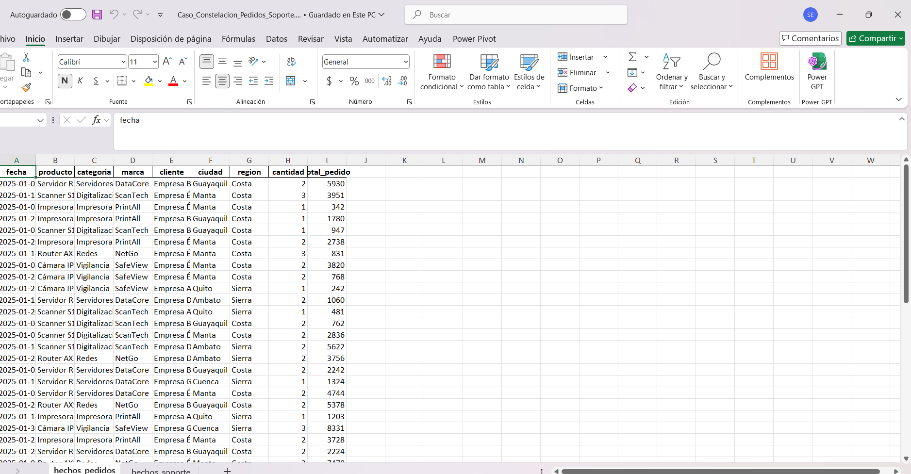
>
> _Descripción: Hojas `hechos_pedidos` y `hechos_soporte` del archivo Excel con sus primeros registros._

---

## Diseño dimensional (Constelación)

Como existen dos procesos de negocio (pedidos y soporte técnico) que se analizan por las mismas perspectivas, se eligió el esquema **constelación**: dos tablas de hechos que comparten las mismas dimensiones. Así se puede cruzar, por ejemplo, cuántas unidades se vendieron de un producto y cuántos tickets generó.

<a id="figura-2"></a>

> **Figura 2:** Modelo constelación diseñado a mano.
>
> 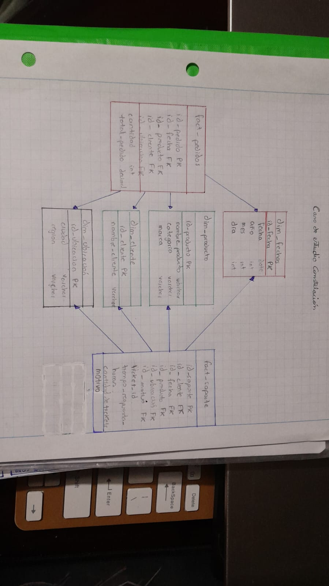
>
> _Descripción: Las tablas `fact_pedidos` y `fact_soporte` se relacionan con las cuatro dimensiones compartidas mediante relaciones uno a muchos (1:\*)._

| Tabla | Tipo | Campos | Responde |
|---|---|---|---|
| `fact_pedidos` | Hechos | `id_pedido`, `id_fecha`, `id_producto`, `id_cliente`, `id_ubicacion`, `cantidad`, `total_pedido` | ¿Cuánto se vendió? |
| `fact_soporte` | Hechos | `id_soporte`, `ticket_id`, `id_fecha`, `id_producto`, `id_cliente`, `id_ubicacion`, `motivo`, `tiempo_respuesta_horas`, `cantidad_tickets` | ¿Cuántos tickets y por qué? |
| `dim_fecha` | Dimensión | `id_fecha`, `fecha`, `anio`, `mes`, `dia`, `dia_semana` | ¿Cuándo? |
| `dim_producto` | Dimensión | `id_producto`, `producto`, `categoria`, `marca` | ¿Qué producto? |
| `dim_cliente` | Dimensión | `id_cliente`, `cliente` | ¿Qué cliente? |
| `dim_ubicacion` | Dimensión | `id_ubicacion`, `ciudad`, `region` | ¿Dónde? |

*   **Dimensiones conformadas:** `dim_fecha`, `dim_producto`, `dim_cliente` y `dim_ubicacion` son las mismas para las dos tablas de hechos; por eso un filtro por ciudad o por producto afecta a pedidos y soporte a la vez.
*   **`motivo` dentro de `fact_soporte`:** Solo tiene 4 valores y no tiene más atributos, por lo que se dejó como **dimensión degenerada** dentro de la tabla de hechos, sin crear una tabla aparte.
*   **`cantidad_tickets`:** Vale 1 en cada registro, de modo que `SUM(cantidad_tickets)` devuelve el número de tickets.

---

## Problemas encontrados

### En los datos

- **`ticket_id` repetido:** El ticket `7221` aparece dos veces, por lo que no puede ser clave primaria. Se usó la clave sustituta `id_soporte` (`SERIAL`) y se conservó `ticket_id` como dato.
- **Datos repetidos en las dos hojas:** Producto, cliente y ubicación se repiten en ambas hojas; para que las dimensiones sean compartidas se unieron los dos flujos y se eliminaron los duplicados antes de cargar.
- **Valores nulos:** No se encontraron celdas vacías. Las fechas vienen en formato `AAAA-MM-DD` y se leyeron como tipo `Date` (`yyyy-MM-dd`).

### Durante la implementación

- **Columnas duplicadas en Pentaho:** Al leer la hoja de soporte con las dos hojas seleccionadas y usar *Add new* en *Get fields*, aparecieron 100 filas y columnas con sufijo `_1`. Se dejó solo la hoja `hechos_soporte` y se usó *Clear and add all*.
- **`Field [] is required` en `dim_fecha`:** Había una fila vacía en *Database fields* del paso *Table output*. Se eliminó y se vaciaron las tablas con `TRUNCATE ... RESTART IDENTITY` antes de volver a ejecutar.
- **Error `"date" is null` en *Database lookup*:** En Pentaho 10.2 la búsqueda por un campo `Date` falló aunque el formato era correcto. Se agregó un paso *Calculator* que obtiene año, mes y día, y la búsqueda de `id_fecha` se hizo por `anio`, `mes` y `dia`.
- **Power BI no encontraba la base `happytech`:** El nombre de la base tenía un carácter oculto al final (longitud 10). Se renombró desde pgAdmin con `ALTER DATABASE`.
- **Compartir el dashboard:** La opción *Compartir* requiere licencia Pro, por lo que el informe se publicó con *Archivo → Insertar informe → Publicar en la web (público)*.

---

## Implementación en PostgreSQL

Se creó la base de datos `happytech` y se ejecutó el script [`01_DDL.sql`](Script-SQL/01_DDL.sql) en el Query Tool de pgAdmin. Primero se crean las cuatro dimensiones y al final las dos tablas de hechos, porque sus claves foráneas (`REFERENCES`) dependen de que las dimensiones existan.

<a id="figura-3"></a>

> **Figura 3:** Creación de tablas en PostgreSQL.
>
> 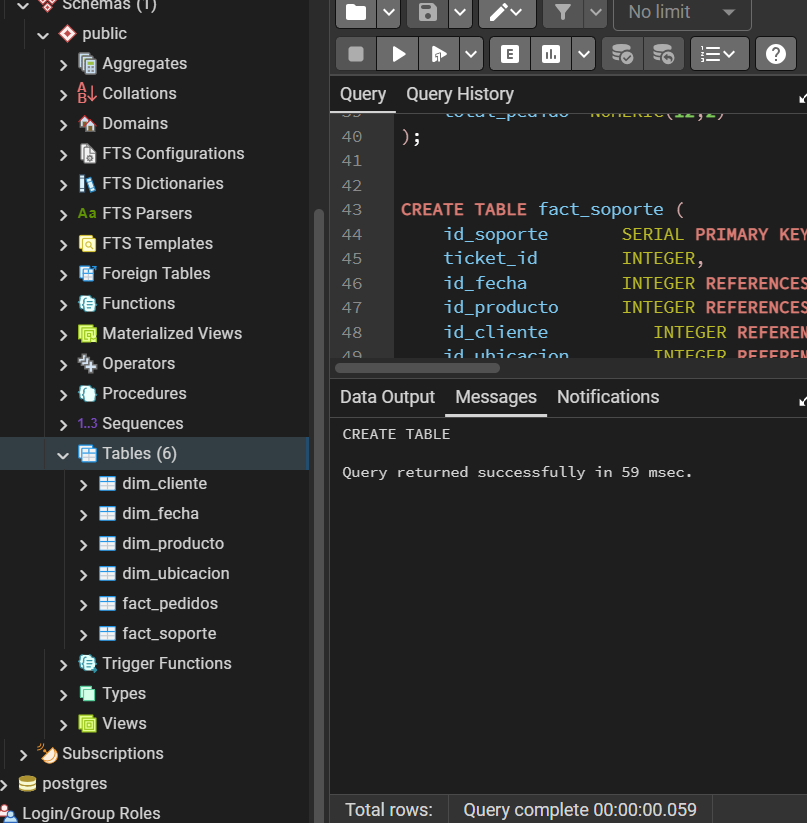
>
> _Descripción: Ejecución del script DDL y verificación de las 6 tablas en el esquema `public` de la base `happytech`._

---

## Proceso ETL en Pentaho

El proceso ETL se desarrolló en **Pentaho Data Integration (Spoon) 10.2** con dos transformaciones y un Job, disponibles en la carpeta [`Pentaho/`](Pentaho/):

| Archivo | Fase | Pasos | Registros |
|---|---|---|---|
| `t1_dimensiones.ktr` | Extracción y transformación | 2 × Microsoft Excel input → Select values → Append streams → 4 × (Unique rows → Table output); *Calculator* para `dim_fecha` | 30 fechas, 5 productos, 5 clientes, 5 ubicaciones |
| `t2_hechos.ktr` | Carga | Por cada hoja: Microsoft Excel input → Calculator → 4 × Database lookup → Table output | 50 pedidos, 50 tickets |
| `job_happytech.kjb` | Orquestación | Start → SQL (`TRUNCATE ... RESTART IDENTITY`) → t1 → t2 → Success | — |

<a id="figura-4"></a>

> **Figura 4:** Conexión de Pentaho a PostgreSQL.
>
> 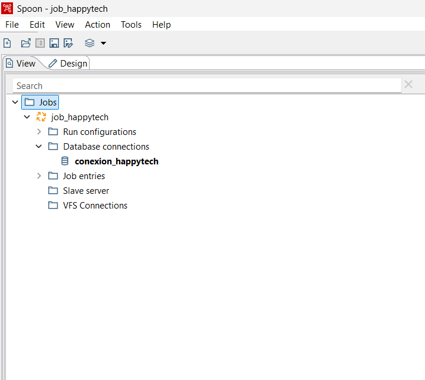
>
> _Descripción: Conexión a PostgreSQL (Native JDBC, `localhost:5432`, base `happytech`) con prueba exitosa._

<a id="figura-5"></a>

> **Figura 5:** Transformación t1_dimensiones.
>
> 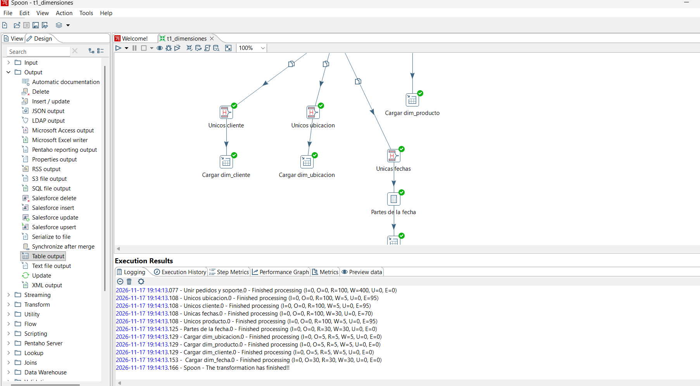
>
> _Descripción: Se leen las dos hojas, se dejan los mismos 7 campos en el mismo orden y se unen con Append streams. Luego cada rama elimina duplicados y carga una dimensión; la rama de fecha calcula año, mes, día y día de la semana._

<a id="figura-6"></a>

> **Figura 6:** Transformación t2_hechos.
>
> 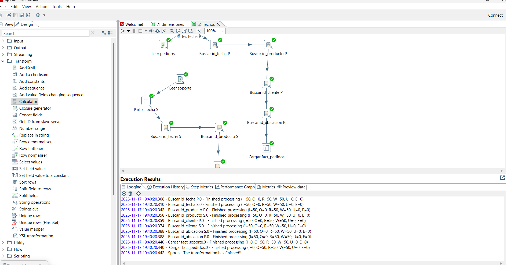
>
> _Descripción: Cada hoja se lee por separado; con Database lookup se obtienen `id_fecha`, `id_producto`, `id_cliente` e `id_ubicacion`, y se insertan 50 registros en `fact_pedidos` y 50 en `fact_soporte`._

<a id="figura-7"></a>

> **Figura 7:** Job job_happytech.
>
> 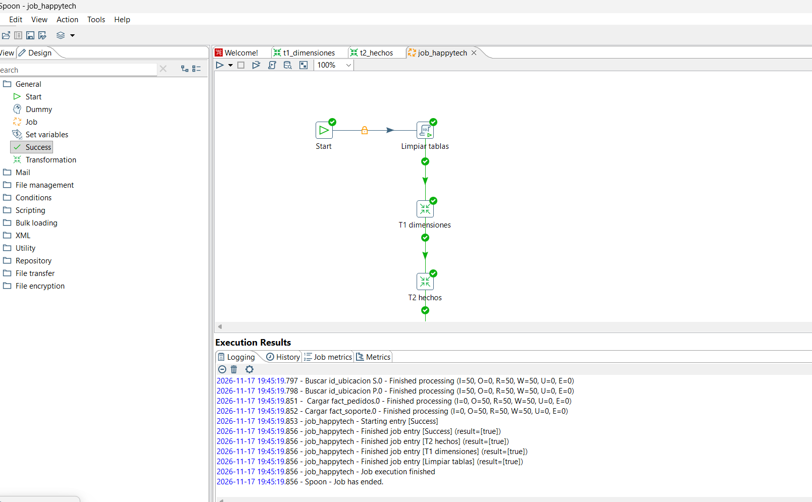
>
> _Descripción: El Job vacía las tablas, ejecuta las dos transformaciones en orden y termina con éxito._

<a id="figura-8"></a>

> **Figura 8:** Comprobación de la carga.
>
> 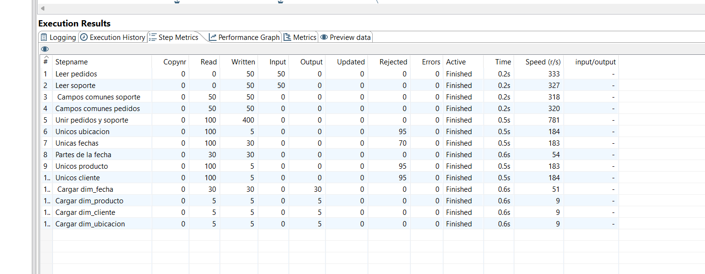
> 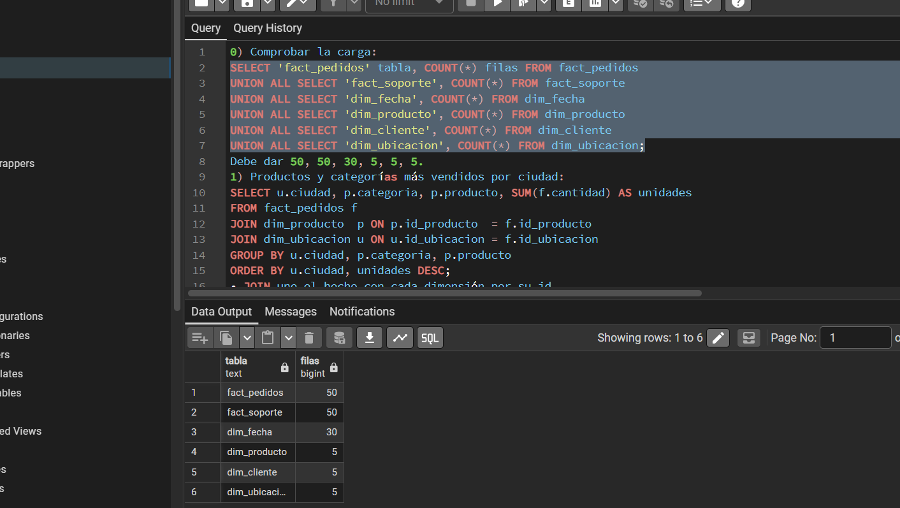
>
> _Descripción: Ejecución de la consulta de comprobación en pgAdmin. Conteo de registros: 30 fechas, 5 productos, 5 clientes, 5 ubicaciones, 50 pedidos y 50 tickets._

---

## Consultas y respuestas a las preguntas

Las consultas están en [`02_consultas.sql`](Script-SQL/02_consultas.sql). En total se vendieron **100 unidades** por **$158.358** y se registraron **50 tickets** con un tiempo de respuesta promedio de **25,2 horas**.

**1. ¿Qué productos o categorías se venden más en cada ciudad?**

| Ciudad | Producto más vendido | Categoría | Unidades |
|---|---|---|---|
| Ambato | Cámara IP C20 | Vigilancia | 9 |
| Cuenca | Cámara IP C20 | Vigilancia | 3 |
| Guayaquil | Router AX10 | Redes | 9 |
| Manta | Impresora Z500 | Impresoras | 9 |
| Quito | Impresora Z500 | Impresoras | 9 |


<a id="figura-9"></a>

> **Figura 9:** Consulta 1 en pgAdmin.
>
> 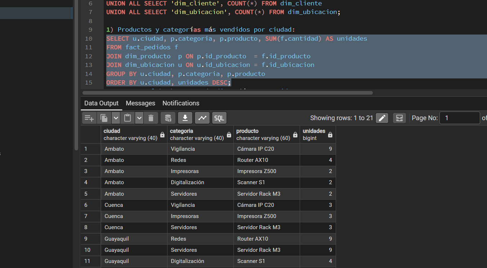
>
> _Descripción: Unidades vendidas por ciudad, categoría y producto (21 filas), ordenadas de mayor a menor dentro de cada ciudad._

En general, la categoría con más unidades es **Impresoras** (24), pero la que más dinero genera es **Redes** ($45.321).

**2. ¿Qué clientes compran más por ciudad?**

| Cliente | Ciudad | Unidades | Ventas |
|---|---|---|---|
| Empresa Épsilon | Manta | 30 | $40.962 |
| Empresa Beta | Guayaquil | 23 | $42.778 |
| Empresa Delta | Ambato | 19 | $28.935 |
| Empresa Alfa | Quito | 19 | $30.724 |
| Empresa Gama | Cuenca | 9 | $14.959 |


<a id="figura-10"></a>

> **Figura 10:** Consulta 2 en pgAdmin.
>
> 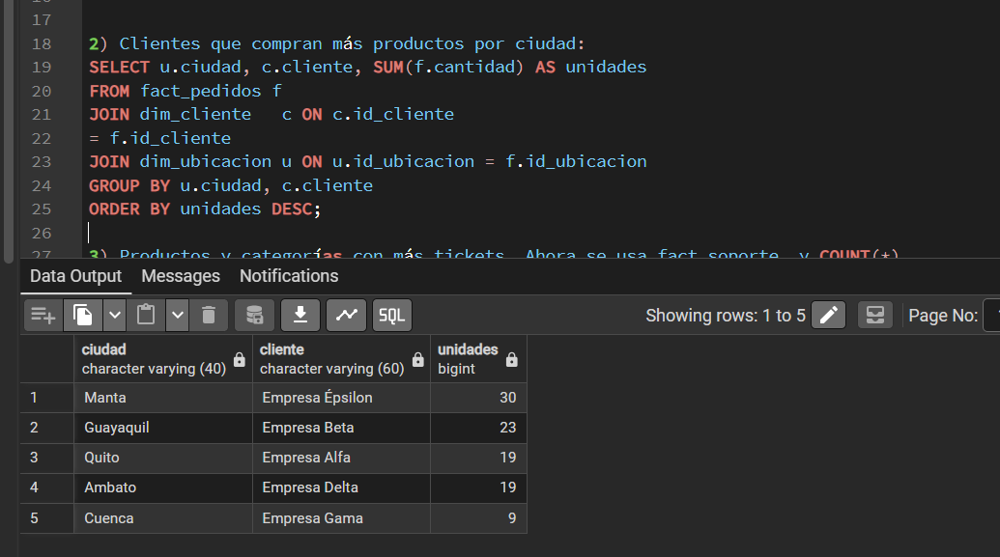
>
> _Descripción: Unidades compradas por cada cliente y su ciudad; Empresa Épsilon (Manta) lidera con 30 unidades._

**3. ¿Qué productos o categorías generan más tickets de soporte?**

| Producto | Categoría | Tickets |
|---|---|---|
| Router AX10 | Redes | 14 |
| Scanner S1 | Digitalización | 10 |
| Servidor Rack M3 | Servidores | 9 |
| Cámara IP C20 | Vigilancia | 9 |
| Impresora Z500 | Impresoras | 8 |


<a id="figura-11"></a>

> **Figura 11:** Consulta 3 en pgAdmin.
>
> 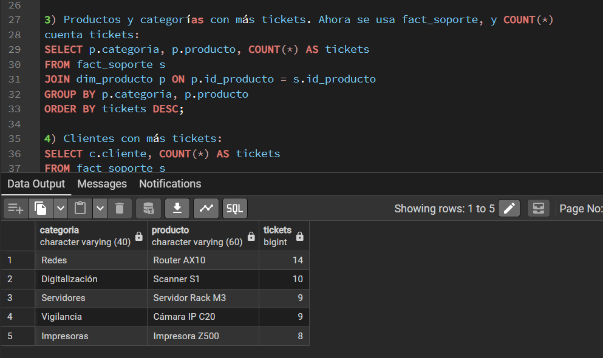
>
> _Descripción: Tickets de soporte por categoría y producto contados con `COUNT(*)` sobre `fact_soporte`; el Router AX10 genera 14 tickets._

El motivo más frecuente es **Falla de hardware** (16 tickets), que además tiene el mayor tiempo de respuesta (28,7 horas).

**4. ¿Qué clientes generan más tickets?**

| Cliente | Tickets |
|---|---|
| Empresa Épsilon | 16 |
| Empresa Gama | 11 |
| Empresa Delta | 9 |
| Empresa Beta | 9 |
| Empresa Alfa | 5 |


<a id="figura-12"></a>

> **Figura 12:** Consulta 4 en pgAdmin.
>
> 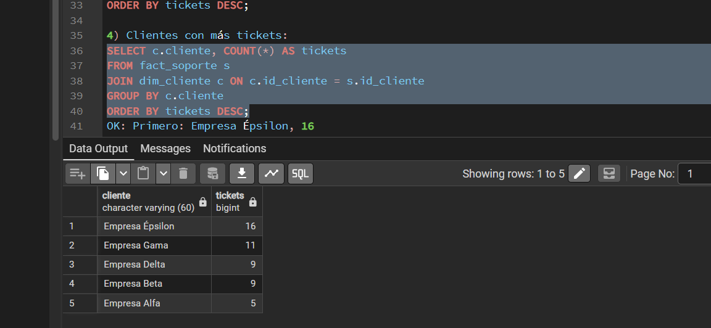
>
> _Descripción: Tickets por cliente; Empresa Épsilon es el cliente con más tickets (16)._

**Análisis cruzado (pedidos y soporte):** Al dividir tickets para unidades vendidas, el **Scanner S1** tiene la proporción más alta (0,77 tickets por unidad) y la **Impresora Z500** la más baja (0,33). Empresa Gama compra poco (9 unidades) pero genera 11 tickets.

---

## Modelo y dashboard en Power BI

Se conectó Power BI Desktop a PostgreSQL (*Obtener datos → Base de datos PostgreSQL*, servidor `127.0.0.1:5432`, base `happytech`) y se cargaron las 6 tablas. Power BI detectó las 8 relaciones del modelo (4 por cada tabla de hechos). Las columnas numéricas que no son medidas se configuraron como *No resumir* y se crearon las medidas DAX:

```DAX
Unidades = SUM(fact_pedidos[cantidad])
Ventas = SUM(fact_pedidos[total_pedido])
Tickets = COUNTROWS(fact_soporte)
Horas promedio = AVERAGE(fact_soporte[tiempo_respuesta_horas])
Tickets por unidad = DIVIDE([Tickets], [Unidades])
```

<a id="figura-13"></a>

> **Figura 13:** Conexión de Power BI Desktop a PostgreSQL.
>
> 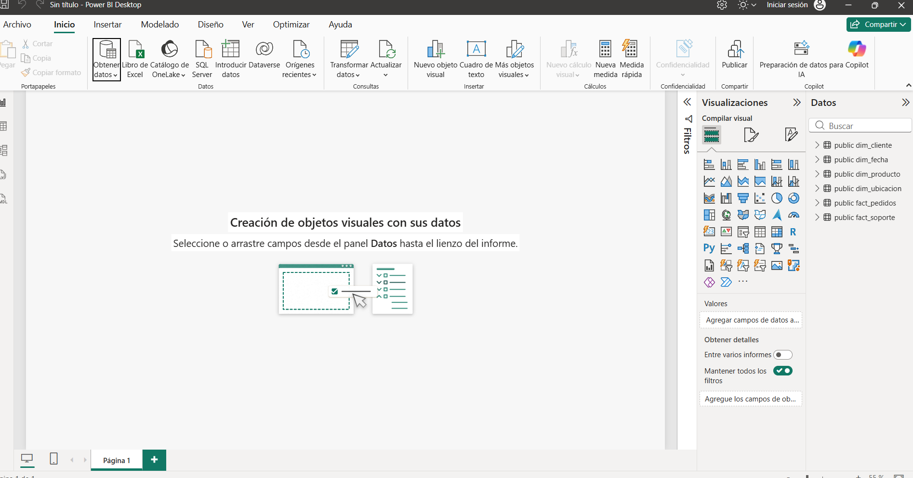
>
> _Descripción: Navegador de Power BI con las 6 tablas de la base `happytech` seleccionadas._

<a id="figura-14"></a>

> **Figura 14:** Modelo constelación en Power BI.
>
> 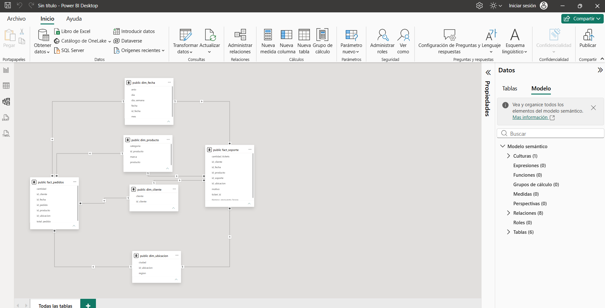
>
> _Descripción: Vista de modelo con las dos tablas de hechos conectadas a las cuatro dimensiones compartidas (relaciones 1:\*)._

<a id="figura-15"></a>

> **Figura 15:** Dashboard HappyTech.
>
> 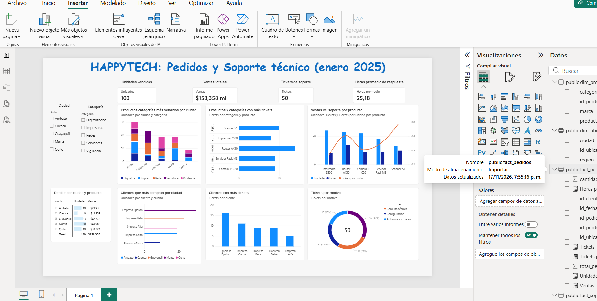
>
> _Descripción: Dashboard "HAPPYTECH: Pedidos y Soporte técnico (enero 2025)" con tarjetas de Unidades, Ventas, Tickets y Horas promedio; segmentadores de ciudad y categoría; y gráficos de unidades por ciudad y categoría, clientes por ciudad, tickets por producto, por cliente y por motivo, y tickets por unidad vendida._

<a id="figura-16"></a>

> **Figura 16:** Publicación del dashboard en la web.
>
> 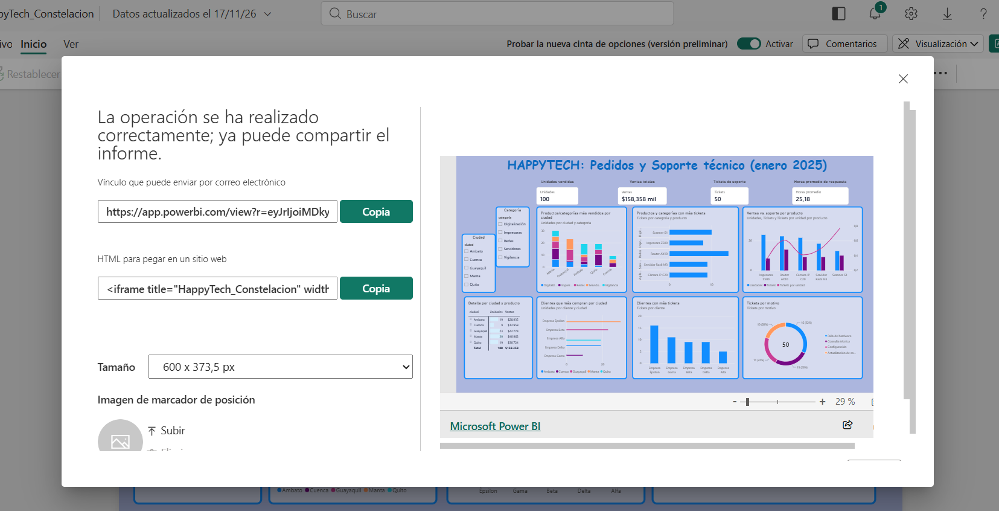
>
> _Descripción: Enlace generado con la opción *Publicar en la web*. El dashboard puede verse en el siguiente [enlace][2]._

---

## Conclusiones

- El esquema constelación permitió analizar pedidos y soporte en un solo modelo, porque las dos tablas de hechos comparten las mismas dimensiones y se pueden filtrar juntas por ciudad, producto o cliente.
- Pentaho automatizó la carga: las dimensiones se obtuvieron de las dos hojas sin duplicados y los hechos se cargaron buscando las claves de cada dimensión.
- Impresoras es la categoría con más unidades vendidas, pero Redes es la que más ingresos genera; el Router AX10 es a la vez de los más vendidos y el que más tickets produce.
- Empresa Épsilon es el cliente que más compra y también el que más tickets genera, por lo que conviene darle un seguimiento especial de soporte.

---

## Referencias bibliográficas

\[1\] Escuela Politécnica Nacional, "Caso de Estudio: Modelo Constelación de Pedidos y Soporte técnico", Facultad de Ingeniería en Sistemas, 2026.

\[2\] R. Kimball y M. Ross, *The Data Warehouse Toolkit: The Definitive Guide to Dimensional Modeling*, 3.ª ed. Indianapolis, IN, EE. UU.: Wiley, 2013.

\[3\] Hitachi Vantara, "Pentaho Data Integration Documentation", 2024. [En línea]. Disponible en: https://docs.hitachivantara.com/

---

## Declaración de uso de IA

Se declara formalmente que el porcentaje de uso de herramientas de inteligencia artificial generativa para la estructuración, redacción de este informe ha sido del **20 %**. La IA se utilizó como apoyo para la redacción y el formato Markdown, mientras que el diseño del modelo, el proceso ETL en Pentaho, la implementación en PostgreSQL, el dashboard en Power BI y las capturas de pantalla son producto del trabajo de los integrantes del grupo.

---

## Enlaces

- Repositorio: [Caso de estudio Constelación][1]
- Dashboard en Power BI: [Ver dashboard HappyTech][2]

[1]: https://github.com/JonathanGuaman2004/Proceso-ETL/blob/main/Caso%20de%20estudio%20Constelaci%C3%B3n
[2]: https://app.powerbi.com/view?r=eyJrIjoiMDkyOGU3ZDEtZTYxZC00MWJiLWE5YTktYTVkNTNhOTQzMGM4IiwidCI6IjY4MmE0ZTZhLWE3N2YtNDk1OC1hM2FjLTllMjY2ZDE4YWEzNyIsImMiOjR9

---
