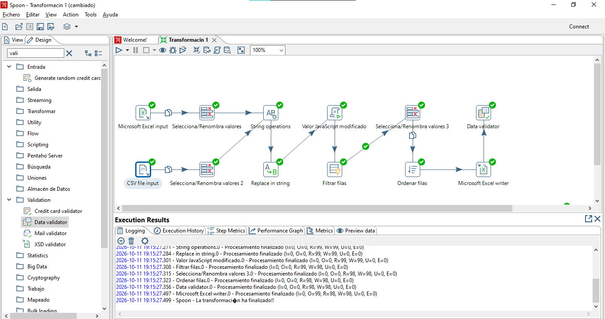
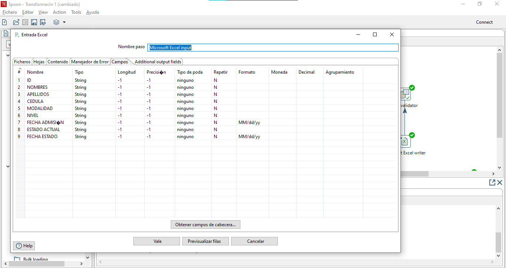
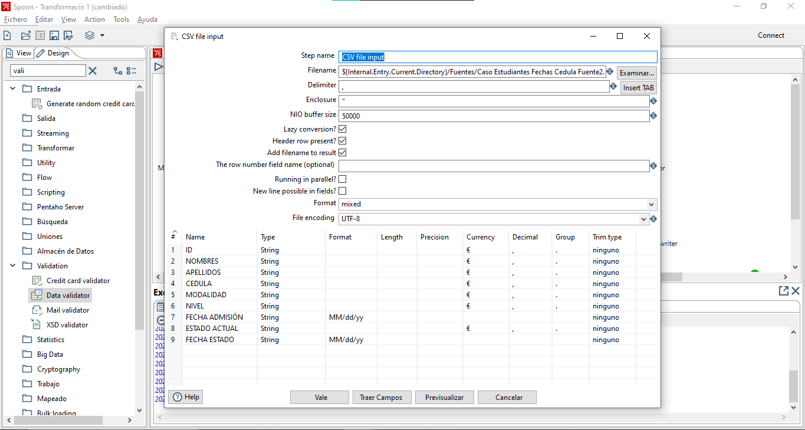
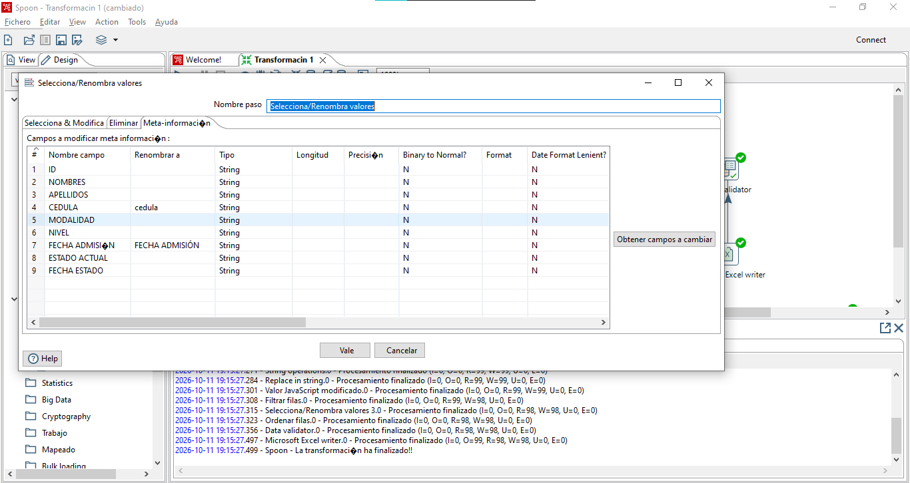
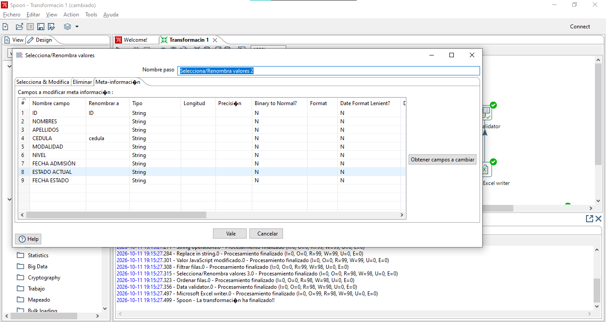
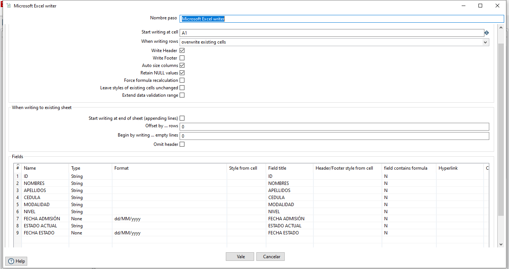
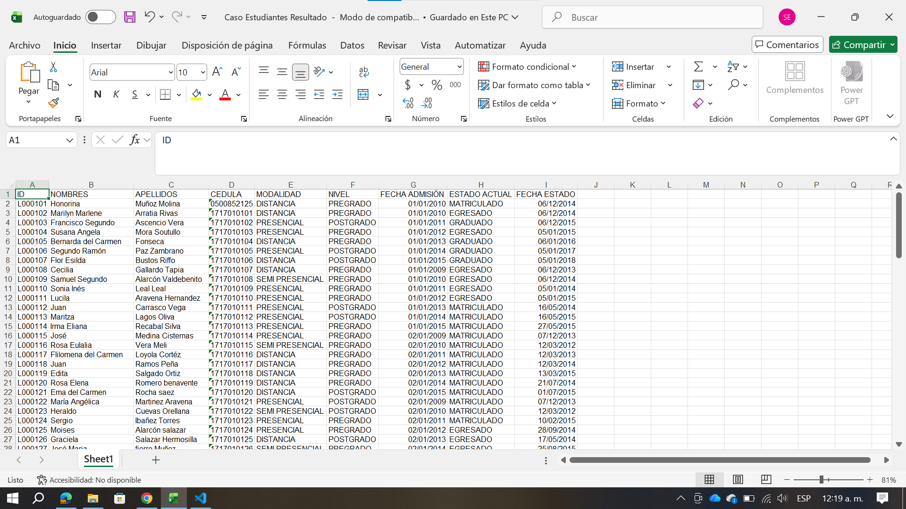

  <!-- Encabezado institucional -->
  

  
<h1 style="color: #FFFFFF; font-size: 25px; margin: 20px 0 8px;">
      ESCUELA POLITÉCNICA NACIONAL
    </h1>

      Facultad de Ingeniería en Sistemas
    

  

  <!-- Línea institucional -->
  

  <!-- Información académica -->
  

      INFORME ACADÉMICO
    

<h2 style="color: #0C233F; font-size: 28px; margin: 20px 0;">
      Procesos ETL
    </h2>

      <strong>Materia:</strong> 
      Business Intelligence
    

 

<!-- Integrantes -->

<h3 style="color: #0C233F; font-size: 17px; margin-top: 0;">
        INTEGRANTES
      </h3>

        Guamán Maza Jonathan Steven 
        Jarrin Román Helen Scarleth 
        Maldonado Simbaña Shirley Estefani 
        Sigcha Diaz Christian David
      

  

  <!-- Pie decorativo -->
  

---
**[Enlace del Repositorio][1]**

---

## Objetivos

### Objetivo General

-

### Objetivos Específicos

- 
-
-

---

## Fuentes de Datos

Se utilizó el archivo Estudiantes.xls que se encuentra en el Aula Virtual de la EPN con los siguientes atributos:

- ID
- NOMBRES
- APELLIDOS
- CEDULA
- MODALIDAD
- NIVEL
- FECHA ADMISIÓN
- ESTADO ACTUAL
- FECHA ESTADO

> **Imagen 1**
> 
> Archivo fuente
>  
> *Imagen tomada del Aula Virtual de la EPN*

Es necesario mencionar que dado que la actividad indicala utilización de 2 fuentes diferentes de datos, se separó el archivo original en otros 2 archivos con diferentes extensiones y datos:
|Nombre|Extensión|Descripción|
|---|---|---|
|`Caso Estudiantes Fechas Cedula Fuente1`|`xls` |hoja de cálculo estándar|
|`Caso Estudiantes Fechas Cedula Fuente2`|`csv`|archivo de texto plano separado por comas|

---

## Problemas encontrados en los datos

- **ID**
  - No se identificaron problemas en los datos de este campo.

- **NOMBRES**
  - Errores en la codificación de caracteres especiales: las vocales con tilde, como `é`, se representan incorrectamente mediante el símbolo `||`.

- **APELLIDOS**
  - Errores en la codificación de caracteres especiales: las vocales con tilde, como `é`, se representan incorrectamente mediante el símbolo `||`.
  - Representación incorrecta del carácter `ñ`, que aparece sustituido por el símbolo `~`.

- **CÉDULA**
  - Presencia de registros con números de cédula de 8 y 9 dígitos, cuando se esperan 10 dígitos.

- **MODALIDAD**
  - Inconsistencias en el uso de mayúsculas y minúsculas para representar los valores del campo.

- **NIVEL**
  - Inconsistencias en el uso de mayúsculas y minúsculas para representar los valores del campo.

- **FECHA ADMISIÓN**
  - Presencia de fechas registradas en diferentes formatos, lo que dificulta su estandarización y procesamiento.

- **ESTADO ACTUAL**
  - Inconsistencias en el uso de mayúsculas y minúsculas.
  - Uso ocasional de abreviaturas, lo que genera falta de uniformidad en los valores registrados.

- **FECHA ESTADO**
  - Presencia de caracteres especiales o símbolos no esperados que afectan la integridad y consistencia de los datos.

---

## Transformaciones aplicadas

- **ID**
  - No se requirieron transformaciones, ya que no se identificaron problemas en los datos de este campo.

- **NOMBRES**
  - Corrección de los caracteres especiales identificados, sustituyendo el símbolo `||` por la letra `é`, según corresponda.

- **APELLIDOS**
  - Corrección de los caracteres especiales identificados, sustituyendo el símbolo `||` por la letra `é`, según corresponda.
  - Corrección de la representación del carácter `ñ`, sustituyendo el símbolo `~` por la letra correspondiente.

- **CÉDULA**
  - Eliminación de los registros con cédulas que contienen menos de 9 dígitos.
  - Adición de un `0` al inicio de las cédulas que contienen exactamente 9 dígitos, para completar los 10 dígitos requeridos.

- **MODALIDAD**
  - Estandarización de los valores mediante la conversión de todos los caracteres al formato de mayúsculas.

- **NIVEL**
  - Estandarización de los valores mediante la conversión de todos los caracteres al formato de mayúsculas.

- **FECHA ADMISIÓN**
  - Estandarización de las fechas mediante la adopción de un único formato, con el fin de garantizar la uniformidad de los datos y facilitar su procesamiento.

- **ESTADO ACTUAL**
  - Sustitución de las abreviaturas identificadas por sus correspondientes términos completos.
  - Estandarización de los valores mediante la conversión de todos los caracteres al formato de mayúsculas.

- **FECHA ESTADO**
  - Eliminación de los caracteres especiales no deseados.
  - Estandarización de las fechas mediante la adopción de un único formato para garantizar la consistencia de los registros.

---

## Flujo ETL desarrollado

> **Imagen 2**
> 
> Flujo ETL
>  
> *Imagen tomada del Aplicativo **Spoon***

### Entrada

> **Imagen 3**
> 
> Entrada de la primer fuente (archivo `.xls`) 
>  
> *Imagen tomada del Aplicativo **Spoon***

> **Imagen 4**
> 
> Entrada de la segunda fuente (archivo `.csv`) 
>  
> *Imagen tomada del Aplicativo **Spoon***

> **Imagen 5**
> 
> Estandarización de los datos de la entrada 1 antes de unirlos en un solo flujo
> 
> *Imagen tomada del Aplicativo **Spoon***

> **Imagen 6**
> 
> Estandarización de los datos de la entrada 2 antes de unirlos en un solo flujo
> 
> *Imagen tomada del Aplicativo **Spoon***

### Transformar

> **Imagen 7**
> 
> 1-String operations
> 
> *Imagen tomada del Aplicativo **Spoon***

> **Imagen 8**
> 
> 2-Replace in string
> 
> *Imagen tomada del Aplicativo **Spoon***

> **Imagen 9**
> 
> 3-Valor JavaScript modificado
> 
> *Imagen tomada del Aplicativo **Spoon***

> **Imagen 10**
> 
> 4-Filtrar filas
> 
> *Imagen tomada del Aplicativo **Spoon***

> **Imagen 11**
> 
> 5-Ordenar filas
> 
> *Imagen tomada del Aplicativo **Spoon***

> **Imagen 12**
> 
> 6-Selecciona Renombra valores
> 
> *Imagen tomada del Aplicativo **Spoon***

### Salida

> **Imagen 13**
> 
> 6-Selecciona Renombra valores
> 
> *Imagen tomada del Aplicativo **Spoon***

> **Imagen 14**
> 
> Salida en formato `.xls`
> 
> *Imagen tomada del Aplicativo **Spoon***

---

## Evidencia del resultado
### Ejecución del proceso

Al ejecutar la transformación, todos los pasos terminaron con el visto verde y sin errores, como se observa en la [**Imagen 2**](#imagen-2). En el panel *Logging* de esa captura, Spoon muestra cuántos registros leyó (R) y escribió (W) cada paso, y que ninguno tuvo errores (E=0):

| Paso | Registros leídos | Registros escritos | Errores |
|---|---|---|---|
| String operations (unión de las dos fuentes) | 99 | 99 | 0 |
| Replace in string | 99 | 99 | 0 |
| Valor JavaScript modificado | 99 | 99 | 0 |
| Filtrar filas | 99 | 98 | 0 |
| Ordenar filas | 98 | 98 | 0 |
| Microsoft Excel writer | 98 | 98 | 0 |
| Data validator | 98 | 98 | 0 |

De los 99 registros que entraron, **98 llegaron a la salida**. El único registro descartado fue el de la cédula `95258652`, que tiene solo 8 dígitos y no se puede completar de forma segura. En cambio, la cédula `500852125`, de 9 dígitos, sí se recuperó agregándole el `0` inicial.

### Configuración de la salida

Los datos limpios se guardan con el paso `Microsoft Excel writer` en el archivo `Caso Estudiantes Resultado.xls`. En este paso se definió el formato `dd/MM/yyyy` para las dos fechas, así todas quedan escritas de la misma manera (ver [**Imagen 14**](#imagen-14)).

### Archivo resultante

Este es el archivo final abierto en Excel. Se puede ver que los datos ya están estandarizados:

> **Imagen 15**
> 
> Archivo `Caso Estudiantes Resultado.xls` con los datos procesados
> 
> *Imagen tomada de Microsoft Excel*

La siguiente tabla compara algunos registros del archivo original con cómo quedaron en el archivo resultante:

| ID | Campo | Antes | Después |
|---|---|---|---|
| L000101 | CEDULA | `500852125` | `0500852125` |
| L000101 | APELLIDOS | `Mu~oz Molina` | `Muñoz Molina` |
| L000101 | FECHA ADMISIÓN | `01/01/2010 0:00` | `01/01/2010` |
| L000101 | FECHA ESTADO | `´12/06/2014` | `06/12/2014` |
| L000102 | MODALIDAD | `Distancia` | `DISTANCIA` |
| L000102 | ESTADO ACTUAL | `Egresado` | `EGRESADO` |
| L000107 | ESTADO ACTUAL | `GRD` | `GRADUADO` |
| L000108 | ESTADO ACTUAL | `EGR` | `EGRESADO` |
| L000110 | NOMBRES | `Sonia In\|\|s` | `Sonia Inés` |
| L000110 | ESTADO ACTUAL | `EGRESADA` | `EGRESADO` |
| L000115 | NOMBRES | `Jos\|\|` | `José` |
| L000118 | APELLIDOS | `Ramos Pe~a` | `Ramos Peña` |
| L000199 | CEDULA | `95258652` | Registro descartado |

### Validación de los resultados

Para comprobar los datos de salida se usó el paso `Data validator`, con una regla llamada *Cedulas* que revisa que el campo CEDULA tenga mínimo 10 caracteres (ver [**Imagen 13**](#imagen-13)).

En la ejecución, el `Data validator` recibió 98 registros y no reportó ningún error, lo que confirma que todas las cédulas de la salida tienen 10 dígitos.

Además, al revisar el archivo resultante ([**Imagen 15**](#imagen-15)) comprobamos que:

- **Cantidad de registros:** entraron 99 y salieron 98. La diferencia es exactamente el registro con cédula inválida, así que no se perdió ningún dato sin explicación.
- **Caracteres especiales:** ya no aparecen los símbolos `||` ni `~`; los nombres y apellidos muestran correctamente la `é` y la `ñ`.
- **Cédulas:** todas tienen 10 dígitos, incluso la que empezaba con `0`.
- **Modalidad y nivel:** todos los valores están en mayúsculas (`PRESENCIAL`, `DISTANCIA`, `SEMI PRESENCIAL`, `PREGRADO`, `POSTGRADO`).
- **Estados:** ESTADO ACTUAL solo contiene `MATRICULADO`, `EGRESADO` y `GRADUADO`.
- **Fechas:** las dos fechas tienen el mismo formato `dd/MM/yyyy`, sin horas ni símbolos sobrantes.

---

## Explicación de cómo el proceso se relaciona con una arquitectura de Data Warehouse.

---

## [Enlace del repositorio de GitHub][1]

---
[1]: https://github.com/JonathanGuaman2004/Proceso-ETL.git
