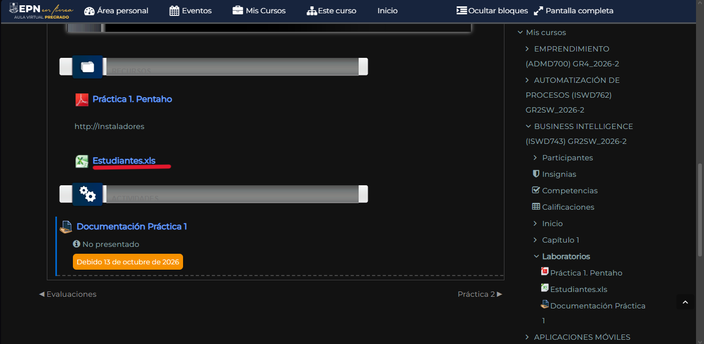

# Trabajo grupal

## Integrantes:

- Guáman Jonathan
- Jarrín Helen
- Maldonado Jarrín
- Sigcha Christian

## Objetivos

### Objetivo General

-

### Objetivos Específicos

- 
-
-

---

## Fuentes de Datos

Se utilizó el archivo Estudiantes.xls que se encuentra en el Aula Virtual de la EPN con los siguientes atributos:

- ID
- NOMBRES
- APELLIDOS
- CEDULA
- MODALIDAD
- NIVEL
- FECHA ADMISIÓN
- ESTADO ACTUAL
- FECHA ESTADO

> **Imagen 1**
> 
>  
> *Imagen tomada del Aula Virtual de la EPN*

Es necesario mencionar que dado que la actividad indicala utilización de 2 fuentes diferentes de datos, se separó el archivo en otros 2 archivos:
|Nombre|Tipo de archivo|Descripción|
|---|---|---|
|`Caso Estudiantes Fechas Cedula Fuente1`|`xls` |hoja de cálculo estándar|
|`Caso Estudiantes Fechas Cedula Fuente2`|`csv`|archivo de texto plano separado por comas|

---

## Problemas Encontrados en los datos

- ID
- NOMBRES
- APELLIDOS
- CEDULA
- MODALIDAD
- NIVEL
- FECHA ADMISIÓN
- ESTADO ACTUAL
- FECHA ESTADO

---

## Transformaciones aplicadas

---

## Flujo ETL desarrollado

---

## Evidencia del resultado

---

## Explicación de cómo el proceso se relaciona con una arquitectura de Data Warehouse.

---

## Enlace del repositorio de GitHub.

---

Presentar en clase:

1. Al dataset provisto añadir dos transformaciones:

- Corregir los nombres y apellidos;
- Validar fechas.

2. Diseñar y ejecutar un proceso ETL utilizando Pentaho Data Integration que incluya:
- dos tipos diferentes de fuentes de datos;
- una etapa de extracción;
- dos transformaciones de limpieza o estandarización;
- una salida con los datos procesados;
- validación de los resultados obtenidos.
Documentar en GitHub mediante Markdown:
1. Objetivo del proceso;
2. Fuentes de datos utilizadas;
3. Problemas encontrados en los datos;
4. Transformaciones aplicadas;
5. Flujo ETL desarrollado;
6. Evidencia del resultado;
7. Explicación de cómo el proceso se relaciona con una arquitectura de Data Warehouse.
Subir el enlace del repositorio de GitHub.